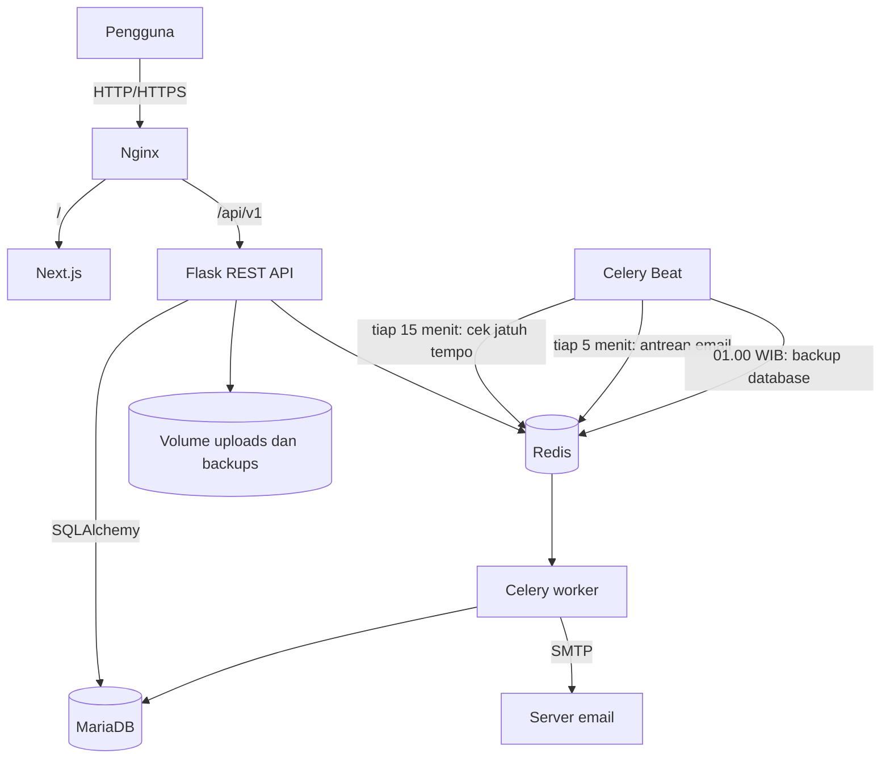

# SIIPB

Sistem Informasi Inventaris Barang, Peminjaman, dan Pengembalian Barang.

SIIPB dipakai petugas Sarpras/IT untuk mendata inventaris, mencatat peminjaman dan pengembalian, memantau barang
yang jatuh tempo atau terlambat, mengirim pengingat lewat email, membuat laporan, dan menyimpan audit aktivitas.
Peminjam tidak perlu punya akun. Semua transaksi dicatat petugas, sedangkan peminjam menerima email konfirmasi,
pengingat, dan pemberitahuan keterlambatan.

Isi:

1. Fitur
2. Arsitektur
3. Basis data
4. Struktur repositori
5. Teknologi
6. Pengujian
7. Menjalankan aplikasi
8. Akun bawaan
9. Dokumentasi lain

## 1. Fitur

Inventaris

- Data barang: kode inventaris, nama, kategori, lokasi, unit pemilik, merek/model, nomor seri, tahun, sumber dan
  nilai perolehan, kondisi, status, serta foto.
- Riwayat perubahan lokasi, kondisi, dan status setiap barang.
- Pencatatan kerusakan dan perbaikan sampai barang kembali berstatus Tersedia.

Peminjaman dan pengembalian

- Petugas memilih peminjam dari master data, memilih satu atau beberapa barang, lalu menentukan tanggal pinjam,
  batas kembali, tujuan, dan catatan. Transaksi bisa disimpan sebagai draf atau langsung diserahkan (checkout).
- Checkout memakai `SELECT ... FOR UPDATE`, sehingga satu barang tidak bisa dipinjamkan dua kali secara bersamaan.
- Pengembalian bisa sebagian. Kondisi barang saat kembali (baik, rusak ringan, diperbaiki, rusak berat, hilang)
  langsung mengubah status barang.
- Bukti peminjaman dan pengembalian dapat dicetak.

Monitoring dan notifikasi

- Daftar transaksi aktif, jatuh tempo dalam 3 hari, terlambat, serta barang rusak atau hilang.
- Pemeriksaan jatuh tempo dijalankan Celery Beat sekali sehari pada jam yang diatur di Pengaturan (bawaan 08.00 WIB).
  Transaksi yang lewat batas diubah menjadi TERLAMBAT.
- Email pengingat H-3, H-1, H, dan H+1 untuk peminjam, H+3 ditambah petugas, dan H+7 ditambah pimpinan. Email yang
  sama tidak dikirim dua kali.

QR / Barcode

- Label QR untuk setiap barang (dibuat dengan `qrcode` di backend) dan cetak label.
- Pencarian barang lewat pemindai QR/barcode USB atau kamera di browser yang mendukung BarcodeDetector.

Laporan

- Laporan inventaris, peminjaman, pengembalian, keterlambatan, serta kerusakan dan kehilangan dalam bentuk PDF,
  Excel, atau cetak.

Keamanan

- Login lokal dengan CAPTCHA gambar, atau SSO melalui OAuth 2.0/OpenID Connect (Authlib).
- JWT access token dan refresh token. Refresh token disimpan sebagai hash SHA-256.
- RBAC dengan 16 permission. Role dan izinnya dapat diatur dari menu Pengguna & Role.
- Audit log mencatat pelaku, waktu, alamat IP, serta data sebelum dan sesudah perubahan.
- Riwayat transaksi tidak pernah dihapus. Relasi memakai `ON DELETE RESTRICT` dan status dibatasi dengan CHECK constraint.

## 2. Arsitektur



## 3. Basis data

MariaDB 11 dengan 23 tabel aplikasi. Skema dikelola dengan Alembic (revisi terbaru `c3e7a9d1f052`).


- Kamus data: [database/README.md](database/README.md)
- Penjelasan ERD dan relasi: [docs/database_erd.md](docs/database_erd.md)
- ERD interaktif (bisa di-zoom, buka di browser): [docs/SIIPB_ERD_diagram.html](docs/SIIPB_ERD_diagram.html)
- ERD format SVG: [database/ERD.svg](database/ERD.svg)
- DDL skema: [database/SIIPB.sql](database/SIIPB.sql)

## 4. Struktur repositori

```text
SIIPB/
├── backend/                      Flask REST API, aturan bisnis, Celery worker dan beat
│   ├── app/
│   │   ├── middleware/           JWT dan RBAC (izin dibaca ulang dari database setiap request)
│   │   ├── models/               model SQLAlchemy
│   │   ├── routes/               endpoint /api/v1 (Swagger di /api/docs)
│   │   ├── schemas/              validasi payload (Marshmallow)
│   │   ├── services/             aturan bisnis, notifikasi, laporan, backup, CAPTCHA
│   │   ├── tasks/                tugas Celery: kirim email, cek jatuh tempo, backup
│   │   └── utils/                keamanan, validasi, format respons
│   ├── alembic/versions/         migrasi skema
│   ├── scripts/seed_data.py      data awal (role, template email, akun)
│   ├── tests/                    pytest dengan database uji terpisah (siipb_test)
│   ├── Dockerfile                Gunicorn, WeasyPrint, mariadb-client
│   └── docker-entrypoint.sh      alembic upgrade head dan seed sebelum start
├── frontend/                     Next.js 16, React 19, TypeScript, Tailwind, shadcn/ui
│   ├── app/ components/ lib/ services/ hooks/ types/
│   ├── tests/                    Vitest (unit) dan Playwright (UI)
│   └── Dockerfile
├── database/                     ERD, kamus data, DDL
├── infrastructure/
│   ├── nginx/                    konfigurasi Nginx HTTP dan HTTPS
│   ├── cloudformation/           template AWS
│   └── scripts/                  backup_db.sh, restore_db.sh, rds_restore_test.sh
├── deploy/scripts/               skrip deploy di server
├── docs/                         dokumentasi teknis dan panduan pengguna
├── .github/workflows/            CI (tes, lint, build) dan deploy
├── docker-compose.yml            Nginx, Next.js, Flask, MariaDB, Redis, Celery worker dan beat
└── .env.example                  contoh konfigurasi (rahasia tidak di-commit)
```

## 5. Teknologi

| Komponen | Teknologi |
|---|---|
| Frontend | Next.js, React, TypeScript, Tailwind CSS, shadcn/ui |
| Backend | Python 3.12, Flask, REST + JSON |
| Dokumentasi API | Swagger (flasgger) di `/api/docs` |
| Database | MariaDB 11, SQLAlchemy 2, Alembic |
| Autentikasi | JWT, OAuth 2.0/OIDC (Authlib), CAPTCHA |
| Antrean dan penjadwal | Redis, Celery, Celery Beat |
| Email | SMTP (STARTTLS/SSL), kata sandi SMTP disimpan terenkripsi |
| QR | `qrcode` |
| Laporan | WeasyPrint (PDF), openpyxl (Excel) |
| Pengujian | pytest, Vitest, Playwright |
| Deployment | Docker Compose, Nginx, GitHub Actions, AWS CloudFormation |
| Penyimpanan berkas | Volume lokal `/app/uploads`, disinkronkan ke S3 di server AWS |

## 6. Pengujian

| Jenis | Isi | Perintah |
|---|---|---|
| Backend | 79 tes: autentikasi, CAPTCHA, RBAC, master data, inventaris, peminjaman, pengembalian, notifikasi H-3 sampai H+7, anti-duplikat, laporan, pengaturan, audit log, backup | `cd backend && pytest` |
| Concurrency | 4 checkout bersamaan pada barang yang sama, hanya 1 yang berhasil | termasuk di atas |
| Frontend unit | 49 tes: tanggal, aturan bisnis, validasi, pemetaan API | `cd frontend && npm test` |
| UI (mode demo) | 7 skenario Playwright | `npm run test:e2e` |
| Integrasi UI dengan API | 4 skenario Playwright | `E2E_API=1 npx playwright test tests/e2e/api.spec.ts` |

Database uji `siipb_test` dibuat ulang setiap kali tes dijalankan, jadi database pengembangan tidak ikut berubah.

## 7. Menjalankan aplikasi

Dengan Docker Compose:

```bash
cp .env.example .env        # ganti semua nilai "ganti-..." (DB, SECRET_KEY, JWT_SECRET_KEY, SEED_ADMIN_PASSWORD)
docker compose up -d --build
```

- Aplikasi: `http://localhost` (untuk HTTPS pakai `NGINX_CONF=nginx.https.conf` dan sertifikat di `infrastructure/nginx/certs/`)
- Swagger: `/api/docs`, health check: `/api/health`
- Container backend menjalankan `alembic upgrade head` dan seed sebelum start.
- Backup otomatis setiap hari pukul 01.00, atau manual dari Pengaturan > Backup MariaDB. Pemulihan memakai
  `infrastructure/scripts/restore_db.sh <berkas>`.
- Langkah rollback ada di [docs/DEVOPS-DEPLOYMENT.md](docs/DEVOPS-DEPLOYMENT.md#rollback-database).

Deploy ke AWS (CloudFormation, GitHub Actions, CloudWatch) dijelaskan di [docs/DEVOPS-DEPLOYMENT.md](docs/DEVOPS-DEPLOYMENT.md).
Cara memakai aplikasi untuk Administrator, Petugas, dan Pimpinan ada di [docs/PANDUAN-PENGGUNA.md](docs/PANDUAN-PENGGUNA.md).

Tanpa Docker, backend dan frontend dijalankan terpisah.

Backend:

```bash
cd backend
python -m venv .venv
# Windows PowerShell: .\.venv\Scripts\Activate.ps1
# Linux/macOS:        source .venv/bin/activate
pip install -r requirements.txt
alembic upgrade head
python scripts/seed_data.py
python run.py                             # http://localhost:5000, Swagger di /api/docs

# worker dan beat (tidak perlu jika NOTIFICATION_DISPATCH=sync)
celery -A celery_app.celery worker --loglevel=info
celery -A celery_app.celery beat --loglevel=info
```

Frontend:

```bash
cd frontend
npm install
cp .env.example .env    # NEXT_PUBLIC_DATA_SOURCE=api, NEXT_PUBLIC_API_BASE_URL=http://localhost:5000/api/v1
npm run dev             # http://localhost:3000, atau NEXT_PUBLIC_DATA_SOURCE=mock untuk mode demo tanpa backend
```

## 8. Akun bawaan

Akun ini dibuat oleh `scripts/seed_data.py` dan juga tersedia di mode demo.

| Role | Username | Email | Kata sandi |
|---|---|---|---|
| Administrator | `admin` | `admin@siipb.local` | `admin123` |
| Petugas Sarpras/IT | `petugas` | `petugas@siipb.local` | `petugas123` |
| Pimpinan | `pimpinan` | `pimpinan@siipb.local` | `pimpinan123` |

Di server sungguhan, atur kata sandi awal lewat `SEED_ADMIN_PASSWORD`, `SEED_PETUGAS_PASSWORD`, dan
`SEED_PIMPINAN_PASSWORD`, lalu ganti kata sandi setelah login pertama.

## 9. Dokumentasi lain

- Swagger: `/api/docs` saat server berjalan
- Daftar endpoint: [docs/api_specification.md](docs/api_specification.md)
- Koleksi Postman: [docs/postman/SIIPB.postman_collection.json](docs/postman/SIIPB.postman_collection.json)
- Panduan SMTP dan SSO: [docs/PANDUAN-SSO-SMTP.md](docs/PANDUAN-SSO-SMTP.md)
- Arsitektur: [docs/architecture.md](docs/architecture.md)
- Repositori: https://github.com/lemonade199/SIIPB
