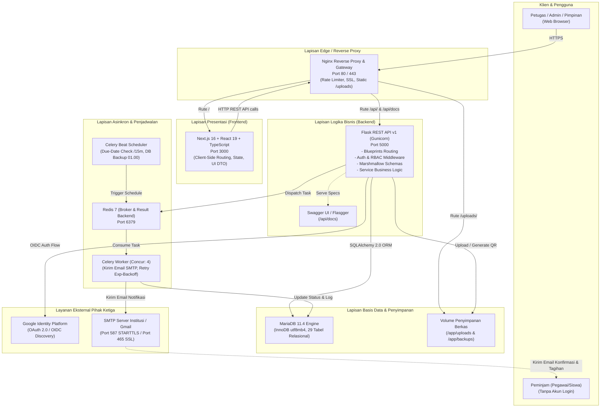
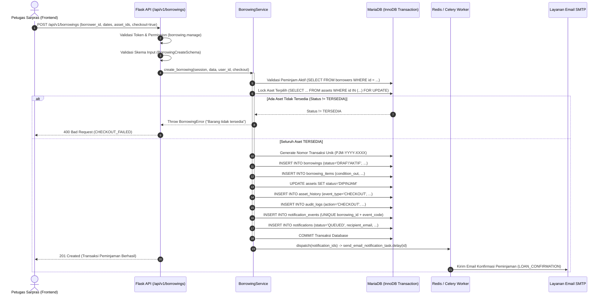
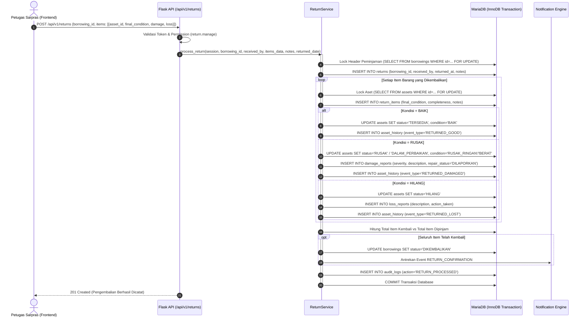
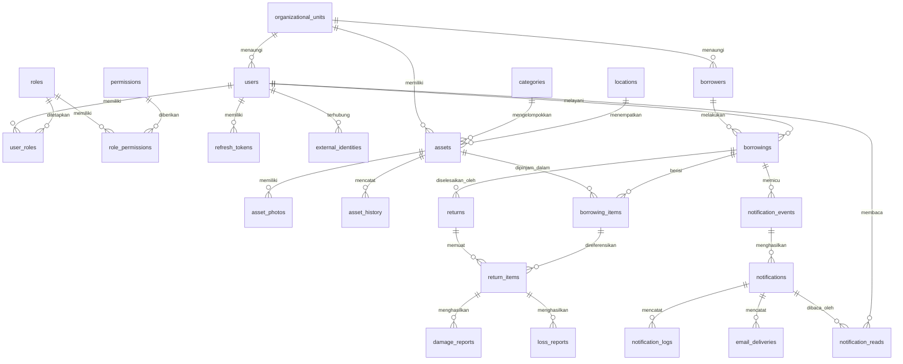

# LAPORAN TEKNIS AUDIT DAN DOKUMENTASI API SISTEM INFORMASI INVENTARIS, PEMINJAMAN, DAN PENGEMBALIAN BARANG (SIIPB)

**Klasifikasi Dokumen:** Laporan Manajemen dan Dokumentasi Teknis  
**Proyek:** Sistem Informasi Inventaris, Peminjaman, dan Pengembalian Barang (SIIPB)  
**Versi Dokumen:** 1.0.0  
**Tanggal Audit:** 14 Oktober 2026  
**Auditor / Penyusun:** Senior Backend Engineer & Technical Documentation Specialist  
**Target Pembaca:** Manajemen Sekolah/Instansi, Kepala Bagian Sarpras & IT, Tim Pengembang Perangkat Lunak  

---

## 1. Ringkasan Eksekutif

### 1.1 Tujuan dan Peran Strategis API
Sistem Informasi Inventaris, Peminjaman, dan Pengembalian Barang (SIIPB) dirancang untuk memodernisasi tata kelola sarana dan prasarana (sarpras) institusi. Antarmuka Pemrograman Aplikasi (*Application Programming Interface* / API) SIIPB memegang peran sentral sebagai tulang punggung (*backbone*) komunikasi data yang menghubungkan antarmuka pengguna (*frontend*) berbasis web dengan lapisan penyimpanan relasional MariaDB dan sistem antrean terdistribusi.

API ini memusatkan seluruh logika bisnis perputaran aset institusi:
1. **Otoritas Validasi Transaksi:** Memastikan aset hanya dapat dipinjam jika berstatus `TERSEDIA`, mencegah reservasi ganda (*double-booking*) melalui penguncian baris database (*pessimistic locking*), serta membatasi hak operasional hanya kepada petugas resmi Sarpras/IT.
2. **Kepatuhan Audit dan Akuntabilitas:** Seluruh mutasi kondisi fisik aset, riwayat pergerakan lokasi, pembatalan peminjaman, serta log insiden kerusakan dan kehilangan dicatat secara *append-only* dengan korelasi identitas pengguna pemroses (*user stamping*).
3. **Automasi Komunikasi dan Eskalasi:** Mengotomatiskan penerbitan bukti peminjaman, pengembalian, serta pengingat jatuh tempo bertingkat (H-3 hingga H+7) melalui perpaduan *event-driven transaction* dan penjadwal berkala (*scheduler worker*).

### 1.2 Ringkasan Tumpukan Teknologi Aktual (*Tech Stack*)
Berdasarkan hasil verifikasi komprehensif terhadap berkas konfigurasi [`backend/requirements.txt`](file:///c:/SIIPB/backend/requirements.txt), [`backend/app/config.py`](file:///c:/SIIPB/backend/app/config.py), [`docker-compose.yml`](file:///c:/SIIPB/docker-compose.yml), serta arsitektur frontend [`frontend/package.json`](file:///c:/SIIPB/frontend/package.json), tumpukan teknologi aktual yang terpasang adalah sebagai berikut:

* **Backend Framework:** Python 3.11/3.12 dengan Flask 3.0.x (arsitektur Application Factory dan Blueprints).
* **Database & ORM:** MariaDB 11.4 (InnoDB, `utf8mb4_unicode_ci`) menggunakan SQLAlchemy 2.0.x (*Modern 2.0 declarative syntax* dan *session management* kontekstual).
* **Manajemen Migrasi Database:** Alembic 1.13.x dengan penomoran revisi schema versioning (`alembic_version`).
* **Autentikasi & Keamanan:** 
  * JWT (*JSON Web Token*) via PyJWT 2.8.x untuk *stateless access tokens*.
  * Hashing kata sandi modern menggunakan Werkzeug `scrypt` dan verifikasi PBKDF2 legacy fallback dengan otomatisasi *re-hashing*.
  * Penyimpanan *refresh token* dengan *cryptographic random token* yang di-hash SHA-256 pada tabel relasional.
  * Google OAuth 2.0 / OpenID Connect (OIDC) terintegrasi via library Authlib 1.3.x dengan validasi *state* dan *nonce*.
  * Enkripsi simetris Fernet (`cryptography`) untuk melindungi kredensial sensitif pihak ketiga (kata sandi SMTP) di dalam database.
* **Sistem Antrean dan Penjadwalan:** Celery 5.3.x berpasangan dengan broker/backend Redis 7.0-Alpine, dilengkapi Celery Beat untuk eksekusi berkala setiap 15 menit dan pencadangan harian pukul 01.00 WIB.
* **Frontend Application:** Next.js 16.3.8 (App Router), React 19.2.8, TypeScript 5, Tailwind CSS 4, Radix UI, Lucide Icons, dan Fetch API Client dengan *in-memory/storage token handling*.
* **Dokumentasi Interaktif:** OpenAPI 2.0 / Swagger UI terintegrasi langsung melalui Flasgger 0.9.7 pada rute `/api/docs`.
* **Infrastruktur & Reverse Proxy:** Nginx 1.27-Alpine bertindak sebagai *single entrypoint*, melayani SSL/TLS termination, kompresi Gzip, *rate limiting* untuk endpoint login, dan *static upload routing*.

### 1.3 Ringkasan Temuan Audit Utama
* **Kelengkapan Endpoint:** Ditemukan sebanyak **86 endpoint kanonikal unik** (atau 99 endpoint jika menghitung 13 endpoint alias `/api/v1/items` yang mencerminkan `/api/v1/assets`). Seluruh endpoint telah terimplementasi penuh pada level *source code* Python, terdaftar dalam routing Flask, dan terikat dengan skema validasi Marshmallow.
* **Kesiapan Database:** Skema database terdiri dari **29 tabel relasional bisnis** ditambah 1 tabel `alembic_version`. Relasi kunci asing (*Foreign Keys*), aturan integritas *CASCADE/RESTRICT*, indeks pencarian, serta batasan nilai (*CHECK constraints*) diterapkan secara ketat.
* **Ketahanan Konkurensi:** Layanan peminjaman ([`borrowing_service.py`](file:///c:/SIIPB/backend/app/services/borrowing_service.py)) telah mengimplementasikan mekanisme *pessimistic row locking* menggunakan klausa `SELECT ... FOR UPDATE` dengan pengurutan `asset_id` guna menjamin bahwa dua transaksi peminjaman bersamaan tidak akan pernah menduplikasi aset yang sama. Hal ini dibuktikan secara empiris melalui unit test konkurensi [`test_concurrent_checkout.py`](file:///c:/SIIPB/backend/tests/test_concurrent_checkout.py).
* **Catatan Perhatian / Limitasi:** Mode pengiriman notifikasi Celery memerlukan kontainer Redis dan Celery Worker yang berjalan aktif di lingkungan *staging/production*. Jika sistem dijalankan dalam lingkungan lokal minimal tanpa Docker, pengiriman otomatis beralih ke mode sinkron (`NOTIFICATION_DISPATCH=sync`).

---

## 2. Gambaran Arsitektur Sistem

### 2.1 Diagram Komunikasi Arsitektur End-to-End
Sistem SIIPB mengadopsi arsitektur *Service-Oriented Decoupled Architecture*, di mana frontend dan backend terpisah secara tegas dan berkomunikasi murni melalui protokol HTTP/REST dengan muatan JSON (*JSON over HTTP*).



### 2.2 Penjelasan Komponen dan Tanggung Jawab
1. **Frontend (Next.js 16 / React 19 / TypeScript):**
   * Bertanggung jawab menyajikan antarmuka visual responsif bagi Admin, Petugas Sarpras, dan Pimpinan.
   * Menangani manajemen token akses dan token pembaruan secara transparan via [`frontend/services/api/client.ts`](file:///c:/SIIPB/frontend/services/api/client.ts).
   * Menerapkan interceptor HTTP yang otomatis meminta access token baru jika server mengembalikan kode `401 TOKEN_EXPIRED_OR_INVALID`.
2. **Reverse Proxy (Nginx 1.27):**
   * Bertindak sebagai pintu gerbang tunggal (*single point of entry*) sistem.
   * Menghilangkan isu *Cross-Origin Resource Sharing* (CORS) di lingkungan produksi dengan mengarahkan `/api/` dan `/` ke port yang sama.
   * Melakukan *rate limiting* ketat pada rute otentikasi (`/api/v1/auth/login`) maksimal 10 request/menit untuk memitigasi serangan *brute force*.
   * Mengirimkan berkas statis foto inventaris langsung dari volume disk (`/uploads/`) dengan konfigurasi *security header* (mencegah eksekusi script jahat `.php`, `.html`, `.js`).
3. **Backend Core (Flask REST API 3.0):**
   * Mengimplementasikan pola *Application Factory* di [`backend/app/__init__.py`](file:///c:/SIIPB/backend/app/__init__.py).
   * Menangani deserialisasi dan sanitasi data request menggunakan *Marshmallow Schemas*.
   * Menyediakan filter otorisasi peran dinamis (*Role-Based Access Control* / RBAC) di [`backend/app/middleware/auth_middleware.py`](file:///c:/SIIPB/backend/app/middleware/auth_middleware.py).
   * Menghasilkan *envelope response* standar yang konsisten untuk seluruh endpoint:
     ```json
     {
       "success": true,
       "message": "Deskripsi status eksekusi",
       "data": { ... },
       "meta": { "page": 1, "per_page": 20, "total": 100 }
     }
     ```
4. **Lapisan Integrasi Data (SQLAlchemy 2.0 & MariaDB 11.4):**
   * Mengelola *connection pooling* (`pool_size=10`, `max_overflow=20`, `pool_recycle=3600`, `pool_pre_ping=True`) untuk memastikan stabilitas koneksi jaringan database.
   * Menegakkan integritas referensial dan isolasi transaksi ACID (*Atomicity, Consistency, Isolation, Durability*).
5. **Background Workers (Celery & Redis):**
   * Menghindarkan operasi I/O jaringan yang lambat (koneksi SMTP dan pengiriman email) dari siklus *request-response* HTTP backend.
   * `celery_worker` memproses antrean email dengan strategi *exponential backoff retry* (hingga 5 kali percobaan).
   * `celery_beat` menjalankan tugas otomatis harian, meliputi sinkronisasi status keterlambatan peminjaman dan pembuatan berkas *database dump* terkompresi.

---

## 3. Cakupan API

### 3.1 Daftar Modul Fungsional
Hasil audit source code backend pada direktori [`backend/app/routes`](file:///c:/SIIPB/backend/app/routes) mengidentifikasi 13 unit modul blueprint yang mencakup seluruh domain bisnis:

1. **Modul System & Health:** Pemantauan status runtime aplikasi, ketersediaan koneksi basis data, dan integritas versi migrasi Alembic.
2. **Modul Authentication & SSO:** Manajemen kredensial internal, rotasi token JWT, Google OAuth 2.0 / OpenID Connect, serta penukaran kode SSO.
3. **Modul Users & RBAC:** Manajemen akun staf internal, pengaturan hierarki peran dinamis (*roles*), dan pemetaan matriks izin granular (*permissions*).
4. **Modul Master Data:** Pengelolaan struktur unit organisasi/jurusan, hierarki lokasi fisik (Gedung/Lantai/Ruang), kategori inventaris, dan data induk peminjam (*borrowers*).
5. **Modul Asset Inventory:** Manajemen siklus hidup aset, penomoran kode otomatis, unggah multi-foto, pelacakan riwayat kondisi, serta *rendering engine* QR Code.
6. **Modul Borrowing (Peminjaman):** Pencatatan draf peminjaman, validasi ketersediaan aset berbasis *row-level locking*, penyerahan barang (*checkout*), dan pembatalan transaksi.
7. **Modul Return & Incidents (Pengembalian):** Penerimaan kembali barang (lengkap maupun parsial), evaluasi kondisi akhir, penerbitan laporan kerusakan (*damage reports*), dan laporan kehilangan (*loss reports*).
8. **Modul Notifications:** Riwayat notifikasi email, pencatatan log pengiriman (*delivery logs*), pengiriman ulang manual, penandaan pesan dibaca (*read receipts*), dan konfigurasi template email dinamis.
9. **Modul Dashboard:** Agregasi Key Performance Indicators (KPI), statistik perputaran barang, grafik tren bulanan, dan daftar peringatan keterlambatan (*overdue monitoring*).
10. **Modul Reports (Pelaporan):** Pratinjau data laporan multi-kriteria serta mesin ekspor dokumen tabular (Excel `.xlsx` via OpenPyXL) dan dokumen cetak resmi (PDF via WeasyPrint).
11. **Modul Settings & System Administration:** Konfigurasi parameter institusi, pengujian konektivitas SMTP, eksekusi manual scheduler keterlambatan, dan manajemen pencadangan basis data (*database backup*).
12. **Modul Audit Trail:** Pemantauan jejak rekam aktivitas seluruh staf dan mutasi entitas sistem beserta snapshot data historis (*before and after snapshot*).
13. **Modul File Uploads:** Layanan penerimaan dan validasi berkas fisik foto barang dan bukti kerusakan dengan verifikasi *magic bytes*.

### 3.2 Statistik Inventaris Endpoint
Berdasarkan audit rute aktual:
* **Jumlah Blueprint Terdaftar:** 13 Blueprint Flask.
* **Jumlah Endpoint Kanonikal Unik:** **86 Endpoint**.
* **Jumlah Rute Aktif Total (termasuk Alias `/api/v1/items`):** **99 Rute**.
* **Distribusi Metode HTTP:**
  * `GET`: 44 endpoint (51.2%)
  * `POST`: 25 endpoint (29.1%)
  * `PUT`: 11 endpoint (12.8%)
  * `DELETE`: 6 endpoint (6.9%)

---

## 4. Katalog Endpoint Komprehensif

Berikut adalah inventaris seluruh endpoint API yang terverifikasi dalam source code project SIIPB:

### 4.1 Modul System & Health
| Method | Endpoint | Fungsi | Parameter / Request Body | Respons Utama | Persyaratan Auth & Role | Bukti Pemeriksaan Source Code |
| :--- | :--- | :--- | :--- | :--- | :--- | :--- |
| `GET` | `/api/health` | Uji kesehatan server, konektivitas database, dan versi migrasi aktif | *None* | `200 OK`<br>`{status: "UP", database: "OK", migration: "a7c3e91d2b40"}`<br>`503 Service Unavailable` | Publik (Tanpa Token) | [`app/__init__.py:L68-L90`](file:///c:/SIIPB/backend/app/__init__.py#L68-L90) |
| `GET` | `/uploads/<path:filename>` | Mengambil file upload statis (foto barang / bukti) di lingkungan development | Path parameter: `filename` | `200 OK` (Binary Stream File) | Publik (Mendukung browser caching) | [`app/__init__.py:L52-L54`](file:///c:/SIIPB/backend/app/__init__.py#L52-L54) |

### 4.2 Modul Authentication & SSO
| Method | Endpoint | Fungsi | Parameter / Request Body | Respons Utama | Persyaratan Auth & Role | Bukti Pemeriksaan Source Code |
| :--- | :--- | :--- | :--- | :--- | :--- | :--- |
| `POST` | `/api/v1/auth/login` | Login akun staf internal menggunakan username dan password | Body: `{username, password}` | `200 OK`<br>`{access_token, refresh_token, token_type, expires_in, user}` | Publik (Rate Limited Nginx) | [`auth_routes.py:L15-L56`](file:///c:/SIIPB/backend/app/routes/auth_routes.py#L15-L56) |
| `POST` | `/api/v1/auth/refresh` | Memperbarui access token yang kedaluwarsa dengan refresh token | Body: `{refresh_token}` | `200 OK`<br>`{access_token, token_type, expires_in}` | Publik (Validasi Token Hash) | [`auth_routes.py:L58-L92`](file:///c:/SIIPB/backend/app/routes/auth_routes.py#L58-L92) |
| `GET` | `/api/v1/auth/me` | Memuat profil pengguna yang sedang login beserta role & permission | *None* | `200 OK`<br>`{id, username, email, full_name, roles, permissions}` | Bearer JWT (Akun Aktif) | [`auth_routes.py:L94-L113`](file:///c:/SIIPB/backend/app/routes/auth_routes.py#L94-L113) |
| `PUT` | `/api/v1/auth/me` | Memperbarui profil mandiri (nama lengkap, email, nomor telepon) | Body: `{full_name, email, phone}` | `200 OK`<br>`{user_profile}` | Bearer JWT (Akun Aktif) | [`auth_routes.py:L115-L156`](file:///c:/SIIPB/backend/app/routes/auth_routes.py#L115-L156) |
| `POST` | `/api/v1/auth/change-password` | Mengganti kata sandi mandiri dan mencabut seluruh sesi lain | Body: `{current_password, new_password}` | `200 OK`<br>`{message: "Kata sandi berhasil diganti..."}` | Bearer JWT (Akun Aktif) | [`auth_routes.py:L158-L191`](file:///c:/SIIPB/backend/app/routes/auth_routes.py#L158-L191) |
| `POST` | `/api/v1/auth/sso/exchange` | Menukar kode sekali pakai (TTL 60s) dari Google OIDC dengan JWT | Body: `{code}` | `200 OK`<br>`{access_token, refresh_token, user}` | Publik (Validasi One-Time Code) | [`auth_routes.py:L193-L221`](file:///c:/SIIPB/backend/app/routes/auth_routes.py#L193-L221) |
| `POST` | `/api/v1/auth/logout` | Melakukan logout dan mencabut refresh token dari database | Body: `{refresh_token}` (opsional) | `200 OK`<br>`{message: "Logout berhasil"}` | Bearer JWT (Akun Aktif) | [`auth_routes.py:L223-L251`](file:///c:/SIIPB/backend/app/routes/auth_routes.py#L223-L251) |
| `GET` | `/api/v1/auth/google` | Inisiasi pengalihan otentikasi Google OAuth 2.0 / OIDC | *None* | `302 Found` (Redirect ke accounts.google.com) | Publik | [`auth_routes.py:L253-L264`](file:///c:/SIIPB/backend/app/routes/auth_routes.py#L253-L264) |
| `GET` | `/api/v1/auth/google/callback` | Callback penerimaan authorization code dari Google OAuth 2.0 | Query: `code`, `state` | `302 Found` (Redirect ke Frontend + `#sso_code=...`) | Publik (Validasi OIDC State/Nonce) | [`auth_routes.py:L266-L293`](file:///c:/SIIPB/backend/app/routes/auth_routes.py#L266-L293) |

### 4.3 Modul Manajemen Pengguna & RBAC
| Method | Endpoint | Fungsi | Parameter / Request Body | Respons Utama | Persyaratan Auth & Role | Bukti Pemeriksaan Source Code |
| :--- | :--- | :--- | :--- | :--- | :--- | :--- |
| `GET` | `/api/v1/users` | Mengambil daftar seluruh pengguna internal | Query: `search` | `200 OK`<br>`data: [UserRow]` | Permission: `users.manage` | [`user_routes.py:L62-L76`](file:///c:/SIIPB/backend/app/routes/user_routes.py#L62-L76) |
| `POST` | `/api/v1/users` | Menambahkan pengguna staf internal baru | Body: `{username, email, full_name, phone, password, role_id, unit_id}` | `201 Created`<br>`data: UserRow` | Permission: `users.manage` | [`user_routes.py:L78-L111`](file:///c:/SIIPB/backend/app/routes/user_routes.py#L78-L111) |
| `GET` | `/api/v1/users/directory` | Direktori nama staf untuk dropdown tampilan transaksi (tanpa data rahasia) | *None* | `200 OK`<br>`data: [{id, full_name, username, roles}]` | Bearer JWT (Seluruh Pengguna Aktif) | [`user_routes.py:L113-L132`](file:///c:/SIIPB/backend/app/routes/user_routes.py#L113-L132) |
| `GET` | `/api/v1/users/<int:user_id>` | Mengambil detail profil dan hak akses pengguna tertentu | Path: `user_id` | `200 OK`<br>`data: UserRow`<br>`404 Not Found` | Permission: `users.manage` | [`user_routes.py:L134-L149`](file:///c:/SIIPB/backend/app/routes/user_routes.py#L134-L149) |
| `PUT` | `/api/v1/users/<int:user_id>` | Memperbarui data pengguna, peran, status aktif, atau reset sandi | Path: `user_id`<br>Body: `{email, full_name, role_id, is_active, password}` | `200 OK`<br>`data: UserRow` | Permission: `users.manage` | [`user_routes.py:L151-L171`](file:///c:/SIIPB/backend/app/routes/user_routes.py#L151-L171) |
| `DELETE` | `/api/v1/users/<int:user_id>` | Menghapus pengguna internal secara soft delete (`deleted_at`) | Path: `user_id` | `200 OK`<br>`{message: "Pengguna dihapus"}` | Permission: `users.manage` | [`user_routes.py:L173-L189`](file:///c:/SIIPB/backend/app/routes/user_routes.py#L173-L189) |
| `GET` | `/api/v1/roles` | Mengambil daftar master role beserta matriks permission terkait | *None* | `200 OK`<br>`data: [RoleRow]` | Permission: `users.manage` | [`user_routes.py:L191-L206`](file:///c:/SIIPB/backend/app/routes/user_routes.py#L191-L206) |
| `POST` | `/api/v1/roles` | Menambahkan master role baru | Body: `{code, name, description, permissions}` | `201 Created`<br>`data: RoleRow` | Permission: `users.manage` | [`user_routes.py:L208-L228`](file:///c:/SIIPB/backend/app/routes/user_routes.py#L208-L228) |
| `PUT` | `/api/v1/roles/<int:role_id>` | Memperbarui konfigurasi nama dan hak akses permission pada role | Path: `role_id`<br>Body: `{name, description, is_active, permissions}` | `200 OK`<br>`data: RoleRow` | Permission: `users.manage` | [`user_routes.py:L230-L251`](file:///c:/SIIPB/backend/app/routes/user_routes.py#L230-L251) |
| `DELETE` | `/api/v1/roles/<int:role_id>` | Menghapus role non-sistem yang sedang tidak ditugaskan ke staf | Path: `role_id` | `200 OK`<br>`{message: "Role dihapus"}` | Permission: `users.manage` | [`user_routes.py:L253-L269`](file:///c:/SIIPB/backend/app/routes/user_routes.py#L253-L269) |
| `GET` | `/api/v1/permissions` | Mengambil seluruh daftar hak akses granular yang tersedia di sistem | *None* | `200 OK`<br>`data: [PermissionRow]` | Permission: `users.manage` | [`user_routes.py:L271-L283`](file:///c:/SIIPB/backend/app/routes/user_routes.py#L271-L283) |

### 4.4 Modul Master Data (Unit, Kategori, Lokasi, Peminjam)
| Method | Endpoint | Fungsi | Parameter / Request Body | Respons Utama | Persyaratan Auth & Role | Bukti Pemeriksaan Source Code |
| :--- | :--- | :--- | :--- | :--- | :--- | :--- |
| `GET` | `/api/v1/organizational-units` | Daftar unit kerja / jurusan institusi | Query: `all` (boolean) | `200 OK`<br>`data: [Unit]` | Bearer JWT (Login) | [`master_routes.py:L34, L98`](file:///c:/SIIPB/backend/app/routes/master_routes.py#L34) |
| `POST` | `/api/v1/organizational-units` | Tambah unit kerja baru | Body: `{code, name, parent_id, description}` | `201 Created`<br>`data: Unit` | Permission: `masterdata.manage` | [`master_routes.py:L34, L99`](file:///c:/SIIPB/backend/app/routes/master_routes.py#L34) |
| `PUT` | `/api/v1/organizational-units/<int:id>`| Ubah data unit kerja | Path: `id`<br>Body: `{name, parent_id, is_active, ...}` | `200 OK`<br>`data: Unit` | Permission: `masterdata.manage` | [`master_routes.py:L34, L100`](file:///c:/SIIPB/backend/app/routes/master_routes.py#L34) |
| `DELETE`| `/api/v1/organizational-units/<int:id>`| Hapus unit kerja | Path: `id` | `200 OK`<br>`{message: "..."}` | Permission: `masterdata.manage` | [`master_routes.py:L34, L101`](file:///c:/SIIPB/backend/app/routes/master_routes.py#L34) |
| `GET` | `/api/v1/categories` | Daftar kategori barang | Query: `all` (boolean) | `200 OK`<br>`data: [Category]` | Bearer JWT (Login) | [`master_routes.py:L35, L98`](file:///c:/SIIPB/backend/app/routes/master_routes.py#L35) |
| `POST` | `/api/v1/categories` | Tambah kategori barang baru | Body: `{code, name, description}` | `201 Created`<br>`data: Category` | Permission: `masterdata.manage` | [`master_routes.py:L35, L99`](file:///c:/SIIPB/backend/app/routes/master_routes.py#L35) |
| `PUT` | `/api/v1/categories/<int:id>` | Ubah data kategori barang | Path: `id`<br>Body: `{name, description, is_active}` | `200 OK`<br>`data: Category` | Permission: `masterdata.manage` | [`master_routes.py:L35, L100`](file:///c:/SIIPB/backend/app/routes/master_routes.py#L35) |
| `DELETE`| `/api/v1/categories/<int:id>` | Hapus kategori barang | Path: `id` | `200 OK`<br>`{message: "..."}` | Permission: `masterdata.manage` | [`master_routes.py:L35, L101`](file:///c:/SIIPB/backend/app/routes/master_routes.py#L35) |
| `GET` | `/api/v1/locations` | Daftar hierarki lokasi fisik (Gedung/Lantai/Ruang) | Query: `all` (boolean) | `200 OK`<br>`data: [Location]` | Bearer JWT (Login) | [`master_routes.py:L36, L98`](file:///c:/SIIPB/backend/app/routes/master_routes.py#L36) |
| `POST` | `/api/v1/locations` | Tambah data lokasi fisik baru | Body: `{code, name, parent_id, description}` | `201 Created`<br>`data: Location` | Permission: `masterdata.manage` | [`master_routes.py:L36, L99`](file:///c:/SIIPB/backend/app/routes/master_routes.py#L36) |
| `PUT` | `/api/v1/locations/<int:id>` | Ubah data lokasi fisik | Path: `id`<br>Body: `{name, parent_id, is_active}` | `200 OK`<br>`data: Location` | Permission: `masterdata.manage` | [`master_routes.py:L36, L100`](file:///c:/SIIPB/backend/app/routes/master_routes.py#L36) |
| `DELETE`| `/api/v1/locations/<int:id>` | Hapus data lokasi fisik | Path: `id` | `200 OK`<br>`{message: "..."}` | Permission: `masterdata.manage` | [`master_routes.py:L36, L101`](file:///c:/SIIPB/backend/app/routes/master_routes.py#L36) |
| `GET` | `/api/v1/borrowers` | Daftar peminjam resmi (tanpa akun login) | Query: `search`, `unit_id`, `all`, `page`, `per_page` | `200 OK`<br>`data: [Borrower], meta` | Bearer JWT (Login) | [`master_routes.py:L109-L131`](file:///c:/SIIPB/backend/app/routes/master_routes.py#L109-L131) |
| `POST` | `/api/v1/borrowers` | Mendaftarkan peminjam baru ke database master | Body: `{name, identity_number, email, phone, position, unit_id}` | `201 Created`<br>`data: Borrower` | Permission: `masterdata.manage` | [`master_routes.py:L133-L153`](file:///c:/SIIPB/backend/app/routes/master_routes.py#L133-L153) |
| `PUT` | `/api/v1/borrowers/<int:borrower_id>` | Memperbarui data profil / status aktif peminjam | Path: `borrower_id`<br>Body: `{name, email, phone, is_active, ...}` | `200 OK`<br>`data: Borrower` | Permission: `masterdata.manage` | [`master_routes.py:L155-L175`](file:///c:/SIIPB/backend/app/routes/master_routes.py#L155-L175) |
| `DELETE`| `/api/v1/borrowers/<int:borrower_id>` | Menghapus peminjam yang belum memiliki transaksi | Path: `borrower_id` | `200 OK`<br>`{message: "Data peminjam dihapus"}` | Permission: `masterdata.manage` | [`master_routes.py:L177-L193`](file:///c:/SIIPB/backend/app/routes/master_routes.py#L177-L193) |

### 4.5 Modul Inventaris Aset (Prefix `/api/v1/assets` & Alias `/api/v1/items`)
| Method | Endpoint | Fungsi | Parameter / Request Body | Respons Utama | Persyaratan Auth & Role | Bukti Pemeriksaan Source Code |
| :--- | :--- | :--- | :--- | :--- | :--- | :--- |
| `GET` | `/api/v1/assets` | Mengambil katalog aset dengan filter dan paginasi | Query: `search, category_id, location_id, status, condition, is_active, page, per_page` | `200 OK`<br>`data: [Asset], meta` | Permission: `inventory.view` | [`asset_routes.py:L69-L107`](file:///c:/SIIPB/backend/app/routes/asset_routes.py#L69-L107) |
| `GET` | `/api/v1/assets/<int:asset_id>` | Detail lengkap aset beserta foto dan status relasi | Path: `asset_id` | `200 OK`<br>`data: Asset`<br>`404 Not Found` | Permission: `inventory.view` | [`asset_routes.py:L109-L125`](file:///c:/SIIPB/backend/app/routes/asset_routes.py#L109-L125) |
| `GET` | `/api/v1/assets/by-code/<path:code>`| Pencarian aset via scan barcode/QR (`SIIPB:<kode>` atau `<kode>`) | Path: `code` | `200 OK`<br>`data: Asset`<br>`404 Not Found` | Permission: `inventory.view` | [`asset_routes.py:L127-L148`](file:///c:/SIIPB/backend/app/routes/asset_routes.py#L127-L148) |
| `POST` | `/api/v1/assets` | Menambah barang (auto generate `inventory_code` bila kosong) | Body: `{name, category_id, location_id, brand, model, serial_number, condition, ...}` | `201 Created`<br>`data: Asset` | Permission: `inventory.manage` | [`asset_routes.py:L150-L191`](file:///c:/SIIPB/backend/app/routes/asset_routes.py#L150-L191) |
| `PUT` | `/api/v1/assets/<int:asset_id>` | Memperbarui spesifikasi, lokasi, atau status aktif aset | Path: `asset_id`<br>Body: `{name, category_id, location_id, is_active, reason, ...}` | `200 OK`<br>`data: Asset` | Permission: `inventory.manage` | [`asset_routes.py:L193-L214`](file:///c:/SIIPB/backend/app/routes/asset_routes.py#L193-L214) |
| `POST` | `/api/v1/assets/<int:asset_id>/status`| Mengubah status manual aset (selesai perbaikan, dsb.) | Path: `asset_id`<br>Body: `{status, reason}` | `200 OK`<br>`data: Asset` | Permission: `inventory.manage` | [`asset_routes.py:L216-L245`](file:///c:/SIIPB/backend/app/routes/asset_routes.py#L216-L245) |
| `DELETE`| `/api/v1/assets/<int:asset_id>` | Menonaktifkan aset (soft delete, riwayat historis tetap aman) | Path: `asset_id` | `200 OK`<br>`{message: "Aset berhasil dinonaktifkan"}` | Permission: `inventory.manage` | [`asset_routes.py:L247-L263`](file:///c:/SIIPB/backend/app/routes/asset_routes.py#L247-L263) |
| `GET` | `/api/v1/assets/<int:asset_id>/history`| Menampilkan audit riwayat mutasi status dan lokasi aset | Path: `asset_id` | `200 OK`<br>`data: [AssetHistory]` | Permission: `inventory.view` | [`asset_routes.py:L265-L298`](file:///c:/SIIPB/backend/app/routes/asset_routes.py#L265-L298) |
| `POST` | `/api/v1/assets/<int:asset_id>/photos`| Mengunggah banyak foto barang sekaligus (maks 5 foto, format JPG/PNG/WEBP) | Path: `asset_id`<br>FormData: `files` (array), `primary` (bool) | `200 OK`<br>`data: Asset` | Permission: `inventory.manage` | [`asset_routes.py:L309-L340`](file:///c:/SIIPB/backend/app/routes/asset_routes.py#L309-L340) |
| `POST` | `/api/v1/assets/<int:asset_id>/upload-photo`| Endpoint kompatibilitas: upload foto tunggal utama | Path: `asset_id`<br>FormData: `file` | `200 OK`<br>`data: {photo_path, ...}` | Permission: `inventory.manage` | [`asset_routes.py:L342-L367`](file:///c:/SIIPB/backend/app/routes/asset_routes.py#L342-L367) |
| `DELETE`| `/api/v1/assets/<int:asset_id>/photos/<int:photo_id>`| Menghapus satu berkas foto barang | Path: `asset_id`, `photo_id` | `200 OK`<br>`data: Asset` | Permission: `inventory.manage` | [`asset_routes.py:L369-L388`](file:///c:/SIIPB/backend/app/routes/asset_routes.py#L369-L388) |
| `PUT` | `/api/v1/assets/<int:asset_id>/photos/order`| Mengatur urutan tampilan foto barang (indeks 0 = utama) | Path: `asset_id`<br>Body: `{photo_ids: [int]}` | `200 OK`<br>`data: Asset` | Permission: `inventory.manage` | [`asset_routes.py:L390-L410`](file:///c:/SIIPB/backend/app/routes/asset_routes.py#L390-L410) |
| `GET` | `/api/v1/assets/<int:asset_id>/qr` | Menghasilkan file gambar QR Code dinamis (`image/svg+xml` atau `image/png`) | Path: `asset_id`<br>Query: `format` (`svg` / `png`) | `200 OK` (Image Stream Content) | Permission: `inventory.view` | [`asset_routes.py:L412-L443`](file:///c:/SIIPB/backend/app/routes/asset_routes.py#L412-L443) |

### 4.6 Modul Peminjaman Barang (*Borrowings*)
| Method | Endpoint | Fungsi | Parameter / Request Body | Respons Utama | Persyaratan Auth & Role | Bukti Pemeriksaan Source Code |
| :--- | :--- | :--- | :--- | :--- | :--- | :--- |
| `GET` | `/api/v1/borrowings` | Daftar transaksi peminjaman dengan filter status dan peminjam | Query: `status, borrower_id, search, page, per_page` | `200 OK`<br>`data: [Borrowing], meta` | Permission: `borrowing.view` | [`borrowing_routes.py:L83-L115`](file:///c:/SIIPB/backend/app/routes/borrowing_routes.py#L83-L115) |
| `GET` | `/api/v1/borrowings/<int:borrowing_id>`| Detail transaksi peminjaman beserta rincian item barang | Path: `borrowing_id` | `200 OK`<br>`data: BorrowingDetail`<br>`404 Not Found` | Permission: `borrowing.view` | [`borrowing_routes.py:L117-L133`](file:///c:/SIIPB/backend/app/routes/borrowing_routes.py#L117-L133) |
| `POST` | `/api/v1/borrowings` | Membuat transaksi peminjaman (`checkout=true`: serahkan langsung; `checkout=false`: simpan DRAF) | Body: `{borrower_id, start_date, due_date, purpose, asset_ids: [int], checkout: bool}` | `201 Created`<br>`data: Borrowing` | Permission: `borrowing.manage` | [`borrowing_routes.py:L135-L177`](file:///c:/SIIPB/backend/app/routes/borrowing_routes.py#L135-L177) |
| `PUT` | `/api/v1/borrowings/<int:borrowing_id>`| Memperbarui transaksi yang masih berstatus DRAF | Path: `borrowing_id`<br>Body: `{borrower_id, start_date, due_date, purpose, asset_ids}` | `200 OK`<br>`data: Borrowing` | Permission: `borrowing.manage` | [`borrowing_routes.py:L179-L199`](file:///c:/SIIPB/backend/app/routes/borrowing_routes.py#L179-L199) |
| `POST` | `/api/v1/borrowings/<int:borrowing_id>/checkout`| Konfirmasi penyerahan barang fisik untuk DRAF (row lock -> status `DIPINJAM`) | Path: `borrowing_id` | `200 OK`<br>`data: Borrowing` | Permission: `borrowing.manage` | [`borrowing_routes.py:L201-L220`](file:///c:/SIIPB/backend/app/routes/borrowing_routes.py#L201-L220) |
| `POST` | `/api/v1/borrowings/<int:borrowing_id>/cancel`| Membatalkan transaksi peminjaman status DRAF dengan mencatat alasan | Path: `borrowing_id`<br>Body: `{reason}` | `200 OK`<br>`data: Borrowing` | Permission: `borrowing.manage` | [`borrowing_routes.py:L222-L246`](file:///c:/SIIPB/backend/app/routes/borrowing_routes.py#L222-L246) |

### 4.7 Modul Pengembalian Barang & Insiden (*Returns, Damage, Loss*)
| Method | Endpoint | Fungsi | Parameter / Request Body | Respons Utama | Persyaratan Auth & Role | Bukti Pemeriksaan Source Code |
| :--- | :--- | :--- | :--- | :--- | :--- | :--- |
| `GET` | `/api/v1/returns` | Daftar transaksi pengembalian barang | Query: `borrowing_id, page, per_page` | `200 OK`<br>`data: [Return], meta` | Permission: `borrowing.view` | [`return_routes.py:L64-L100`](file:///c:/SIIPB/backend/app/routes/return_routes.py#L64-L100) |
| `GET` | `/api/v1/returns/<int:return_id>`| Detail transaksi pengembalian dan item kondisi barang | Path: `return_id` | `200 OK`<br>`data: ReturnDetail`<br>`404 Not Found` | Permission: `borrowing.view` | [`return_routes.py:L102-L122`](file:///c:/SIIPB/backend/app/routes/return_routes.py#L102-L122) |
| `POST` | `/api/v1/returns` | Memproses pengembalian barang (pengecekan kondisi, rusak, hilang, parsial/penuh) | Body: `{borrowing_id, notes, returned_date, items: [{borrowing_item_id, asset_id, final_condition, damage, loss}]}` | `201 Created`<br>`data: ReturnDetail` | Permission: `return.manage` | [`return_routes.py:L124-L214`](file:///c:/SIIPB/backend/app/routes/return_routes.py#L124-L214) |
| `GET` | `/api/v1/damage-reports` | Daftar laporan kerusakan barang inventaris pasca peminjaman | Query: `repair_status, severity, page, per_page` | `200 OK`<br>`data: [DamageReport], meta` | Permission: `borrowing.view` | [`return_routes.py:L217-L283`](file:///c:/SIIPB/backend/app/routes/return_routes.py#L217-L283) |
| `PUT` | `/api/v1/damage-reports/<int:report_id>/repair-status`| Memperbarui siklus hidup perbaikan kerusakan (`DILAPORKAN` -> `SELESAI`) | Path: `report_id`<br>Body: `{repair_status, action_taken, repair_cost}` | `200 OK`<br>`data: {id, repair_status, resolved_at}` | Permission: `return.manage` | [`return_routes.py:L285-L337`](file:///c:/SIIPB/backend/app/routes/return_routes.py#L285-L337) |
| `GET` | `/api/v1/loss-reports` | Daftar laporan insiden kehilangan barang | Query: `page, per_page` | `200 OK`<br>`data: [LossReport], meta` | Permission: `borrowing.view` | [`return_routes.py:L340-L386`](file:///c:/SIIPB/backend/app/routes/return_routes.py#L340-L386) |

### 4.8 Modul Notifikasi & Template Email
| Method | Endpoint | Fungsi | Parameter / Request Body | Respons Utama | Persyaratan Auth & Role | Bukti Pemeriksaan Source Code |
| :--- | :--- | :--- | :--- | :--- | :--- | :--- |
| `GET` | `/api/v1/notifications` | Daftar riwayat notifikasi email dan log pengiriman SMTP | Query: `status, event, borrowing_id, inbox, page, per_page` | `200 OK`<br>`data: [Notification], meta` | Permission: `notification.view` | [`notification_routes.py:L73-L110`](file:///c:/SIIPB/backend/app/routes/notification_routes.py#L73-L110) |
| `GET` | `/api/v1/notifications/unread-count`| Menghitung jumlah notifikasi yang belum dibaca pengguna (badge lonceng) | *None* | `200 OK`<br>`data: {unread: int}` | Bearer JWT (Login) | [`notification_routes.py:L112-L127`](file:///c:/SIIPB/backend/app/routes/notification_routes.py#L112-L127) |
| `POST` | `/api/v1/notifications/<int:id>/read`| Menandai satu notifikasi sebagai telah dibaca pengguna | Path: `id` | `200 OK`<br>`data: {id, read: true}` | Bearer JWT (Login) | [`notification_routes.py:L129-L148`](file:///c:/SIIPB/backend/app/routes/notification_routes.py#L129-L148) |
| `POST` | `/api/v1/notifications/read-all`| Menandai seluruh notifikasi di kotak masuk pengguna sebagai telah dibaca | *None* | `200 OK`<br>`data: {marked: int}` | Bearer JWT (Login) | [`notification_routes.py:L150-L169`](file:///c:/SIIPB/backend/app/routes/notification_routes.py#L150-L169) |
| `POST` | `/api/v1/notifications/<int:id>/resend`| Mengantrekan ulang notifikasi email yang gagal terkirim | Path: `id` | `200 OK`<br>`data: Notification` | Permission: `notification.manage` | [`notification_routes.py:L171-L196`](file:///c:/SIIPB/backend/app/routes/notification_routes.py#L171-L196) |
| `GET` | `/api/v1/notifications/templates` | Mengambil seluruh template email aktif beserta daftar placeholder | *None* | `200 OK`<br>`data: [NotificationTemplate]` | Permission: `notification.view` | [`notification_routes.py:L219-L233`](file:///c:/SIIPB/backend/app/routes/notification_routes.py#L219-L233) |
| `PUT` | `/api/v1/notifications/templates/<int:id>`| Memperbarui subjek, bodi HTML, atau status aktif template email | Path: `id`<br>Body: `{name, subject, body, is_active}` | `200 OK`<br>`data: NotificationTemplate` | Permission: `settings.manage` | [`notification_routes.py:L235-L261`](file:///c:/SIIPB/backend/app/routes/notification_routes.py#L235-L261) |

### 4.9 Modul Dashboard & Pemantauan
| Method | Endpoint | Fungsi | Parameter / Request Body | Respons Utama | Persyaratan Auth & Role | Bukti Pemeriksaan Source Code |
| :--- | :--- | :--- | :--- | :--- | :--- | :--- |
| `GET` | `/api/v1/dashboard/summary` | Ringkasan metrik statistik (total aset per status, peminjaman aktif, keterlambatan) | *None* | `200 OK`<br>`data: {inventory, transactions, incidents, recent_activities}` | Permission: `dashboard.view` | [`dashboard_routes.py:L12-L24`](file:///c:/SIIPB/backend/app/routes/dashboard_routes.py#L12-L24) |
| `GET` | `/api/v1/dashboard/overdue` | Daftar detail peminjaman terlambat beserta durasi hari dan level eskalasi | *None* | `200 OK`<br>`data: [OverdueLoan], meta` | Any Permission: `monitoring.view`, `dashboard.view` | [`dashboard_routes.py:L26-L39`](file:///c:/SIIPB/backend/app/routes/dashboard_routes.py#L26-L39) |
| `GET` | `/api/v1/dashboard/statistics` | Data tren bulanan peminjaman/pengembalian, barang terpopuler, dan ketepatan waktu | Query: `months` (default: 12) | `200 OK`<br>`data: {monthly_trends, popular_assets, on_time_rate}` | Any Permission: `dashboard.view`, `report.view` | [`dashboard_routes.py:L41-L55`](file:///c:/SIIPB/backend/app/routes/dashboard_routes.py#L41-L55) |

### 4.10 Modul Pelaporan (*Reports*)
| Method | Endpoint | Fungsi | Parameter / Request Body | Respons Utama | Persyaratan Auth & Role | Bukti Pemeriksaan Source Code |
| :--- | :--- | :--- | :--- | :--- | :--- | :--- |
| `GET` | `/api/v1/reports` | Mengambil katalog jenis laporan yang didukung oleh sistem | *None* | `200 OK`<br>`data: [{type, title}]` | Permission: `report.view` | [`report_routes.py:L17-L28`](file:///c:/SIIPB/backend/app/routes/report_routes.py#L17-L28) |
| `GET` | `/api/v1/reports/<rtype>` | Menghasilkan laporan: pratinjau JSON, file Excel OpenPyXL (`.xlsx`), atau PDF WeasyPrint | Path: `rtype`<br>Query: `format` (`json`/`xlsx`/`pdf`), `from`, `to`, `unit_id`, `category_id`, `location_id`, `status` | `200 OK` (JSON Envelope atau Binary File Attachment) | Pratinjau JSON: `report.view`<br>Ekspor File: `report.export` | [`report_routes.py:L30-L83`](file:///c:/SIIPB/backend/app/routes/report_routes.py#L30-L83) |

### 4.11 Modul Pengaturan Sistem, Scheduler & Backup
| Method | Endpoint | Fungsi | Parameter / Request Body | Respons Utama | Persyaratan Auth & Role | Bukti Pemeriksaan Source Code |
| :--- | :--- | :--- | :--- | :--- | :--- | :--- |
| `GET` | `/api/v1/settings` | Mengambil konfigurasi sistem (user biasa hanya menerima subset publik) | *None* | `200 OK`<br>`data: SystemSettings` | Bearer JWT (Login) | [`settings_routes.py:L20-L38`](file:///c:/SIIPB/backend/app/routes/settings_routes.py#L20-L38) |
| `GET` | `/api/v1/settings/public` | Informasi identitas instansi dan status SSO untuk tampilan login | *None* | `200 OK`<br>`data: {institution, unit_sarpras, oidc_enabled}` | Publik (Tanpa Token) | [`settings_routes.py:L40-L55`](file:///c:/SIIPB/backend/app/routes/settings_routes.py#L40-L55) |
| `PUT` | `/api/v1/settings` | Memperbarui pengaturan instansi, SMTP, scheduler, dan parameter | Body: `Partial<SystemSettings>` | `200 OK`<br>`data: SystemSettings` | Permission: `settings.manage` | [`settings_routes.py:L57-L73`](file:///c:/SIIPB/backend/app/routes/settings_routes.py#L57-L73) |
| `POST` | `/api/v1/settings/smtp/test`| Menguji konektivitas soket dan autentikasi ke server SMTP | *None* | `200 OK`<br>`{data: {ok: true, mode: "smtp"}}` | Permission: `settings.manage` | [`settings_routes.py:L75-L107`](file:///c:/SIIPB/backend/app/routes/settings_routes.py#L75-L107) |
| `POST` | `/api/v1/scheduler/run` | Menjalankan pemeriksaan jatuh tempo dan eskalasi keterlambatan secara manual | Body: `{date}` (opsional untuk simulasi) | `200 OK`<br>`data: SchedulerRunResult` | Permission: `notification.manage` | [`settings_routes.py:L110-L142`](file:///c:/SIIPB/backend/app/routes/settings_routes.py#L110-L142) |
| `GET` | `/api/v1/scheduler/runs` | Riwayat log eksekusi scheduler pemeriksaan keterlambatan | Query: `limit` (default: 50) | `200 OK`<br>`data: [SchedulerRun]` | Any Permission: `notification.view`, `notification.manage` | [`settings_routes.py:L144-L160`](file:///c:/SIIPB/backend/app/routes/settings_routes.py#L144-L160) |
| `GET` | `/api/v1/backups` | Mengambil daftar file arsip cadangan basis data yang tersedia | *None* | `200 OK`<br>`data: [BackupFileEntry]` | Permission: `settings.manage` | [`settings_routes.py:L163-L176`](file:///c:/SIIPB/backend/app/routes/settings_routes.py#L163-L176) |
| `POST` | `/api/v1/backups` | Memicu pembuatan dump basis data MariaDB baru (`.sql.gz`) | *None* | `200 OK`<br>`data: BackupFileEntry` | Permission: `settings.manage` | [`settings_routes.py:L178-L197`](file:///c:/SIIPB/backend/app/routes/settings_routes.py#L178-L197) |
| `GET` | `/api/v1/backups/<name>` | Mengunduh file arsip basis data terkompresi Gzip | Path: `name` | `200 OK` (Stream Attachment Gzip) | Permission: `settings.manage` | [`settings_routes.py:L199-L218`](file:///c:/SIIPB/backend/app/routes/settings_routes.py#L199-L218) |

### 4.12 Modul Audit Trail & Upload Bukti
| Method | Endpoint | Fungsi | Parameter / Request Body | Respons Utama | Persyaratan Auth & Role | Bukti Pemeriksaan Source Code |
| :--- | :--- | :--- | :--- | :--- | :--- | :--- |
| `GET` | `/api/v1/audit-logs` | Mengambil rekaman jejak audit sistem dengan multi-filter | Query: `module, action, user_id, entity_type, entity_id, from, to, page, per_page` | `200 OK`<br>`data: [AuditLog], meta` | Permission: `audit.view` | [`audit_routes.py:L13-L123`](file:///c:/SIIPB/backend/app/routes/audit_routes.py#L13-L123) |
| `POST` | `/api/v1/uploads` | Mengunggah bukti foto kerusakan, dokumen, atau lampiran | FormData: `file` (binary), `folder` (`assets`/`evidence`) | `201 Created`<br>`data: {file_url: "/uploads/..."}` | Any Permission: `inventory.manage`, `return.manage` | [`upload_routes.py:L11-L52`](file:///c:/SIIPB/backend/app/routes/upload_routes.py#L11-L52) |

---

## 5. Alur Proses Bisnis Utama

Berikut adalah penelusuran teknis komprehensif mulai dari pengiriman request di sisi frontend hingga persistensi data di MariaDB:

### 5.1 Alur Transaksi Peminjaman Barang (*Borrowing Lifecycle*)


* **Endpoint Penerima:** `POST /api/v1/borrowings` ([`borrowing_routes.py:L135`](file:///c:/SIIPB/backend/app/routes/borrowing_routes.py#L135)).
* **File Implementasi Bisnis:** [`backend/app/services/borrowing_service.py`](file:///c:/SIIPB/backend/app/services/borrowing_service.py).
* **Fungsi Utama Backend:** [`create_borrowing()`](file:///c:/SIIPB/backend/app/services/borrowing_service.py#L151), [`_lock_available_assets()`](file:///c:/SIIPB/backend/app/services/borrowing_service.py#L77), [`_checkout()`](file:///c:/SIIPB/backend/app/services/borrowing_service.py#L107).
* **Tabel Database yang Terlibat:**
  * `borrowings`: Menyimpan header transaksi, nomor transaksi berurut, dan tenggat waktu.
  * `borrowing_items`: Menyimpan rincian ID aset yang dipinjam serta kondisi saat keluar (`condition_out`).
  * `assets`: Kolom `status` dimutasi dari `TERSEDIA` menjadi `DIPINJAM`.
  * `asset_history`: Rekaman peristiwa `CHECKOUT` dicatat secara *append-only*.
  * `audit_logs`: Mencatat ID petugas, IP, dan snapshot perubahan data.
  * `notification_events` & `notifications`: Mencatat antrean pesan konfirmasi peminjaman.

### 5.2 Alur Transaksi Pengembalian Barang (*Return Lifecycle*)


* **Endpoint Penerima:** `POST /api/v1/returns` ([`return_routes.py:L124`](file:///c:/SIIPB/backend/app/routes/return_routes.py#L124)).
* **File Implementasi Bisnis:** [`backend/app/services/return_service.py`](file:///c:/SIIPB/backend/app/services/return_service.py).
* **Fungsi Utama Backend:** [`process_return()`](file:///c:/SIIPB/backend/app/services/return_service.py#L46).
* **Penanganan Kasus Khusus:**
  * **Pengembalian Sebagian (*Partial Return*):** Sistem membandingkan jumlah baris di `return_items` dengan `borrowing_items`. Transaksi peminjaman tetap berstatus `AKTIF` atau `TERLAMBAT` hingga item terakhir selesai diproses.
  * **Kerusakan Aset:** Jika `final_condition = RUSAK`, sistem otomatis membuat baris pada tabel `damage_reports` dan memperbarui `asset.status` menjadi `RUSAK`, `RUSAK_BERAT`, atau `DALAM_PERBAIKAN`.
  * **Kehilangan Aset:** Jika `final_condition = HILANG`, sistem mencatat insiden ke tabel `loss_reports` dan memperbarui status aset menjadi `HILANG`.

### 5.3 Alur Manajemen Inventaris (*Asset Lifecycle*)
* **Penambahan Aset Baru (`POST /api/v1/assets`):**
  * Fungsi: [`create_asset()`](file:///c:/SIIPB/backend/app/services/asset_service.py#L65).
  * Menghasilkan kode inventaris otomatis berbasis kategori (misal: `INV-ELK-0001`) jika pengguna mengosongkan kolom kode.
  * Mencatat entri awal ke `asset_history` dengan `event_type = CREATED`.
* **Pembaruan dan Perubahan Status Manual (`PUT /assets/<id>` dan `POST /assets/<id>/status`):**
  * Fungsi: [`update_asset()`](file:///c:/SIIPB/backend/app/services/asset_service.py#L104) dan [`change_status()`](file:///c:/SIIPB/backend/app/services/asset_service.py#L137).
  * Status `DIPINJAM` diproteksi secara ketat dan **ditolak** jika diubah melalui endpoint manual (hanya diizinkan melalui proses checkout peminjaman resmi).
* **Penanganan Bukti Foto dan QR Code:**
  * Penyimpanan foto diverifikasi terhadap tipe MIME dan *magic bytes* header berkas, disimpan dengan nama UUID acak, serta dicatat relasinya ke tabel `asset_photos`.
  * Endpoint `/api/v1/assets/<id>/qr` membaca payload format `SIIPB:<kode_inventaris>` dan me-render citra vektor SVG secara *on-the-fly* tanpa membebani media penyimpanan fisik.

### 5.4 Alur Autentikasi dan Otorisasi (*Security Flow*)
* **Login Tradisional (Username / Password):**
  1. Frontend mengirim kredensial ke `POST /api/v1/auth/login`.
  2. Backend memvalidasi format input via `LoginSchema`.
  3. [`authenticate_user()`](file:///c:/SIIPB/backend/app/services/auth_service.py#L52) mencari record pengguna di tabel `users`.
  4. Kata sandi diverifikasi dengan hash `scrypt`. Jika terdeteksi hash legacy PBKDF2, sistem langsung memperbaruinya ke `scrypt`.
  5. Terbit sepasang token: Access Token (JWT, masa berlaku 60 menit) dan Refresh Token (kriptografi acak 64-byte).
  6. Hash SHA-256 dari Refresh Token disimpan ke tabel `refresh_tokens`.
* **Login Single Sign-On (Google OAuth 2.0 / OIDC):**
  1. Pengguna diarahkan ke `GET /api/v1/auth/google`.
  2. Modul `authlib` menghasilkan pengalihan ke akun Google dengan perlindungan parameter *state* dan *nonce*.
  3. Setelah sukses, Google mengalihkan ke `GET /api/v1/auth/google/callback`.
  4. Backend mencocokkan subjek Google di tabel `external_identities` atau memetakan alamat email ke akun staf yang cocok via [`resolve_oauth_user()`](file:///c:/SIIPB/backend/app/services/auth_service.py#L110).
  5. Backend menerbitkan *Single-Use Authorization Code* berdurasi 60 detik (disimpan di Redis/Memory) dan mengarahkan browser ke `FRONTEND_URL/login#sso_code=...`.
  6. Frontend menangkap fragmen URL dan menukarkannya via `POST /api/v1/auth/sso/exchange` untuk mendapatkan JWT resmi.
* **Otorisasi Runtime Per Permintaan (*Middleware Verification*):**
  * Melalui decorator [`@jwt_required`](file:///c:/SIIPB/backend/app/middleware/auth_middleware.py#L32), backend membaca ulang akun dan hak akses pengguna secara langsung dari database pada **setiap request**.
  * Konsekuensi arsitektural: jika seorang staf dinonaktifkan (`is_active = False`) atau hak aksesnya dicabut oleh Admin, perubahan tersebut **seketika berlaku** tanpa perlu menunggu JWT habis masa berlakunya.

---

## 6. Integrasi Basis Data (MariaDB & SQLAlchemy)

### 6.1 Pemetaan Model SQLAlchemy dan Tabel MariaDB
Sistem SIIPB mendefinisikan 29 tabel relasional yang dikelola melalui SQLAlchemy 2.0 dan terdaftar penuh di [`backend/app/models/__init__.py`](file:///c:/SIIPB/backend/app/models/__init__.py). Sumber kebenaran skema (*source of truth*) dikendalikan oleh migrasi Alembic di [`backend/alembic/versions`](file:///c:/SIIPB/backend/alembic/versions).



### 6.2 Ringkasan Entitas Tabel Basis Data
1. **Domain Keamanan & RBAC (5 Tabel):**
   * `users`: Data induk akun staf, password hash, status aktif, dan nomor kontak.
   * `roles`: Master peran dinamis (`ADMIN`, `SARPRAS`, `PIMPINAN`).
   * `permissions`: Master izin akses atomik (misal: `borrowing.manage`, `inventory.view`).
   * `user_roles`: Relasi *many-to-many* antara pengguna dan peran yang diemban.
   * `role_permissions`: Relasi *many-to-many* antara peran dan izin akses granular.
2. **Domain Otentikasi Sesi (2 Tabel):**
   * `refresh_tokens`: Hash SHA-256 refresh token, masa kedaluwarsa, dan status pencabutan (*revoked*).
   * `external_identities`: Pemetaan subjek Google OAuth/OIDC ke `user_id`.
3. **Domain Data Induk Organisasi (4 Tabel):**
   * `organizational_units`: Struktur hierarki unit kerja institusi / jurusan.
   * `borrowers`: Data peminjam (guru/siswa/karyawan) **tanpa akun login aplikasi**.
   * `categories`: Kategori klasifikasi barang inventaris.
   * `locations`: Hierarki fisik penempatan aset (Gedung > Lantai > Ruangan).
4. **Domain Inventaris Aset Fisik (3 Tabel):**
   * `assets`: Data fisik barang, nomor seri, sumber perolehan, status, kondisi, dan QR payload.
   * `asset_history`: Log kronologis riwayat mutasi status dan lokasi aset (*append-only*).
   * `asset_photos`: Berkas foto dokumentasi barang (maksimal 5 foto per aset).
5. **Domain Transaksi Operasional (4 Tabel):**
   * `borrowings`: Header transaksi peminjaman (nomor invoice, tanggal pinjam, jatuh tempo).
   * `borrowing_items`: Daftar barang spesifik yang dipinjam beserta kondisi keluar.
   * `returns`: Header pengembalian barang fisik dan identitas staf penerima.
   * `return_items`: Detail kondisi barang saat kembali (`BAIK`, `RUSAK`, `HILANG`).
6. **Domain Manajemen Insiden (2 Tabel):**
   * `damage_reports`: Laporan kerusakan fisik, estimasi biaya, dan siklus perbaikan.
   * `loss_reports`: Laporan berita acara kehilangan barang dan tindakan ganti rugi.
7. **Domain Sistem Notifikasi & Email (7 Tabel):**
   * `notification_templates`: Template subjek dan bodi pesan HTML dengan tag placeholder.
   * `notification_events`: Kunci idempotensi unik: `UNIQUE(borrowing_id, event_code)`.
   * `notifications`: Snapshot pesan siap kirim per penerima individual.
   * `notification_logs`: Catatan siklus hidup pembuatan dan antrean pesan.
   * `email_deliveries`: Log detail percobaan kirim SMTP per percobaan (*attempt trace*).
   * `notification_reads`: Pencatatan notifikasi yang telah dibaca oleh staf internal.
   * `scheduler_runs`: Log riwayat eksekusi cron penjadwal pemeriksaan keterlambatan.
8. **Domain Konfigurasi & Kepatuhan (2 Tabel):**
   * `system_settings`: Penyimpanan konfigurasi dinamis aplikasi (*key-value JSON*).
   * `audit_logs`: Jejak audit forensik aktivitas mutasi data oleh staf dan sistem.

### 6.3 Integritas Data, Transaksi, dan Pencegahan Race Condition
* **Integritas Relasional:** Seluruh relasi vital dilindungi aturan integritas referensial. Tabel anak pada transaksi (`borrowing_items`, `return_items`) menerapkan `ON DELETE RESTRICT` untuk mencegah penghapusan data induk yang memiliki keterikatan transaksi historis.
* **Isolasi Transaksi Database:** Seluruh proses checkout peminjaman dan pemrosesan pengembalian dibungkus dalam blok transaksi database tunggal:
  ```python
  with SessionLocal() as session:
      try:
          # seluruh mutasi tabel borrowings, items, assets, history, dan notifikasi
          session.commit()
      except Exception:
          session.rollback()
          raise
  ```
  Jika terjadi kegagalan pada salah satu tahap (misalnya ketiadaan stok atau anomali data), seluruh mutasi dibatalkan secara atomik (*rollback*), menjamin konsistensi basis data.
* **Penanganan Konkurensi / *Double-Booking*:**
  Pada [`backend/app/services/borrowing_service.py:L82`](file:///c:/SIIPB/backend/app/services/borrowing_service.py#L82), ketersediaan aset dikunci menggunakan klausa `with_for_update=True` pada baris aset yang telah diurutkan berdasarkan `id`:
  ```python
  for asset_id in sorted(set(asset_ids)):
      asset = session.get(Asset, asset_id, with_for_update=True, populate_existing=True)
      if asset.status != AssetStatus.TERSEDIA.value or not asset.is_active:
          bad.append(...)
  ```
  Pengurutan `asset_id` secara deterministik mencegah terjadinya kondisi saling kunci (*deadlock*) antarthread, sedangkan `FOR UPDATE` memaksa transaksi paralel lainnya menunggu hingga transaksi pertama selesai, sehingga mustahil terjadi peminjaman ganda atas satu aset fisik yang sama.

---

## 7. Keamanan dan Keandalan Sistem

### 7.1 Autentikasi dan Otorisasi (RBAC)
* **Klaim Identitas Dinamis:** Token akses JWT membawa klaim identitas ringkas, namun hak akses permission dievaluasi langsung dari basis data pada setiap request melalui [`_load_identity()`](file:///c:/SIIPB/backend/app/middleware/auth_middleware.py#L16). Hal ini meniadakan celah keamanan akibat keterlambatan propagasi hak akses (*stale claims*).
* **Role ADMIN Universal Bypass:** Khusus role `ADMIN`, sistem memberikan bypass otomatis terhadap seluruh batasan izin, sementara peran staf lainnya dievaluasi secara presisi melalui izin spesifik (`permission_required`) atau izin alternatif (`any_permission_required`).

### 7.2 Validasi Input dan Keamanan Parameter
* **Skema Marshmallow Ketat:** Setiap payload JSON yang masuk divalidasi tipe data, panjang string, batas nilai, dan pola regex-nya (misalnya validasi username: `^[a-zA-Z0-9._-]{3,100}$`).
* **Proteksi File Upload:**
  Fungsi [`save_upload_file()`](file:///c:/SIIPB/backend/app/services/storage_service.py#L32) menerapkan 4 lapis proteksi:
  1. Pembatasan direktori target hanya pada folder aman (`SAFE_FOLDERS = {"assets", "evidence", "documents"}`).
  2. Pengecekan ekstensi file (`.jpg`, `.jpeg`, `.png`, `.webp`, `.pdf`).
  3. Pengecekan *Magic Bytes* (memeriksa signature biner awal berkas untuk mendeteksi pemalsuan ekstensi).
  4. Penggantian nama file menjadi format UUIDv4 acak guna mencegah serangan *Path Traversal* (`../`).

### 7.3 Penanganan Kesalahan dan Kode Status HTTP
API secara konsisten menggunakan kode status standar HTTP:
* `200 OK` / `201 Created`: Permintaan berhasil diproses.
* `400 Bad Request`: Kesalahan validasi input pengguna atau pelanggaran aturan bisnis (disertai objek rincian `errors`).
* `401 Unauthorized`: Ketiadaan token, token kedaluwarsa, atau format Authorization salah.
* `403 Forbidden`: Pengguna terautentikasi namun tidak memiliki izin peran yang dipersyaratkan.
* `404 Not Found`: Entitas atau rute tidak ditemukan.
* `413 Request Entity Too Large`: Ukuran berkas unggahan melebihi ambang batas konfigurasi.
* `500 Internal Server Error`: Kesalahan server internal tidak terduga (rincian error disembunyikan dari klien dan dicatat ke log server).

### 7.4 Pengelolaan Kredensial dan Rahasia
* Kata sandi akun staf disimpan menggunakan algoritma `scrypt` berkeamanan tinggi.
* Kredensial pihak ketiga yang dapat diubah dari UI (seperti kata sandi server SMTP institusi) dienkripsi menggunakan algoritma simetris Fernet dengan kunci yang diturunkan dari `SECRET_KEY` server ([`settings_service.py`](file:///c:/SIIPB/backend/app/services/settings_service.py#L16)). Kredensial ini dimaskir dan tidak pernah dikembalikan ke antarmuka pengguna dalam bentuk teks polos (*plaintext*).

### 7.5 Pengujian Otomatis (*Automated Test Suite*)
Sistem backend dilengkapi dengan rangkaian pengujian otomatis unit dan integrasi berbasis `pytest` pada direktori [`backend/tests`](file:///c:/SIIPB/backend/tests):
* [`test_auth.py`](file:///c:/SIIPB/backend/tests/test_auth.py): Pengujian alur login, rotasi refresh token, profil, dan perubahan sandi.
* [`test_assets.py`](file:///c:/SIIPB/backend/tests/test_assets.py): Pengujian validasi CRUD aset, filter paginasi, dan pergerakan riwayat status.
* [`test_borrowing.py`](file:///c:/SIIPB/backend/tests/test_borrowing.py): Pengujian siklus draf, checkout, dan validasi aset tersedia.
* [`test_concurrent_checkout.py`](file:///c:/SIIPB/backend/tests/test_concurrent_checkout.py): Pengujian multi-threading konkurensi checkout simultan untuk memverifikasi keandalan penguncian database.
* [`test_returns.py`](file:///c:/SIIPB/backend/tests/test_returns.py): Pengujian pengembalian penuh, pengembalian parsial, pelaporan kerusakan, dan pelaporan kehilangan.
* [`test_scheduler.py`](file:///c:/SIIPB/backend/tests/test_scheduler.py): Pengujian logika deteksi keterlambatan H-3 hingga H+7 dan pencegahan duplikasi event notifikasi.
* [`test_reports_settings.py`](file:///c:/SIIPB/backend/tests/test_reports_settings.py): Pengujian pembuatan laporan tabular dan konfigurasi dinamis.

---

## 8. Status Implementasi dan Temuan Audit

Berdasarkan audit komparatif antara dokumentasi rencana dan *source code* aktual:

### 8.1 Fitur yang Telah Terverifikasi Lengkap (*Fully Implemented*)
1. **Otentikasi Ganda:** Login internal berbasis password dan Single Sign-On (Google OAuth 2.0 / OIDC) telah terpasang dan berfungsi penuh.
2. **Katalog & Mutasi Aset:** Penomoran otomatis, manajemen foto, pembuatan QR Code dinamis (SVG/PNG), serta pencatatan kronologis riwayat mutasi aset telah terimplementasi menyeluruh.
3. **Siklus Transaksi Peminjaman:** Alur draf, pembatalan draf berargumen, dan checkout dengan *pessimistic locking* terbukti kokoh dan lulus uji konkurensi.
4. **Siklus Transaksi Pengembalian:** Penanganan fleksibel atas pengembalian sebagian (*partial return*), evaluasi kondisi akhir barang, integrasi laporan kerusakan, dan laporan kehilangan beroperasi sesuai spesifikasi.
5. **Mesin Pelaporan Beragam Format:** Pratinjau JSON, pembuatan file Excel (`openpyxl`), dan ekspor dokumen PDF resmi (`weasyprint`) terintegrasi rapi dengan filter multi-parameter.
6. **Audit Trail Komprehensif:** Setiap tindakan operasional staf tercatat pada tabel `audit_logs` secara otomatis melalui `record_audit()`.

### 8.2 Fitur Parsial / Bergantung Lingkungan (*Environment-Dependent*)
1. **Pengiriman Notifikasi Email Asinkron:**
   * Implementasi kode backend sudah lengkap mendukung Celery Worker dan antrean Redis.
   * *Status Runtime:* Efektivitas pengiriman email bergantung pada tersedianya kredensial SMTP yang valid di pengaturan aplikasi serta berjalannya kontainer Celery Worker. Pada lingkungan pengujian tanpa worker, sistem beralih ke mode sinkron (`sync`).
2. **Pencadangan Database Otomatis:**
   * Fitur pencadangan memanfaatkan utilitas command-line `mariadb-dump` / `mysqldump` pada sistem operasi. Fitur ini berjalan sempurna di dalam kontainer Docker resmi, namun memerlukan binary `mariadb-dump` terpasang di path sistem host jika backend dijalankan di luar Docker.

### 8.3 Analisis Risiko dan Rekomendasi Teknis untuk Tim IT
1. **Risiko Ukuran Tabel Audit Log & History:**
   * *Temuan:* Seluruh operasi pencatatan mutasi bersifat *append-only*. Pada volume transaksi institusi berskala besar, tabel `audit_logs` dan `asset_history` akan bertumbuh sangat pesat.
   * *Rekomendasi:* Implementasikan strategi pengarsipan data historis berkala (*table partitioning* atau cron pembersihan log di atas 2 tahun) agar kinerja query indeks tetap optimal.
2. **Pemeliharaan Sertifikat OAuth Google:**
   * *Temuan:* Integrasi Google OAuth memerlukan konfigurasi `GOOGLE_CLIENT_ID` dan `GOOGLE_CLIENT_SECRET` di file `.env`.
   * *Rekomendasi:* Pastikan Authorized Redirect URI di Google Cloud Console selalu disinkronkan saat terjadi perubahan domain produksi atau konfigurasi IP publik sekolah.
3. **Penyimpanan Berkas Foto Berskala Besar:**
   * *Temuan:* Berkas foto saat ini disimpan pada volume lokal disk (`/app/uploads`).
   * *Rekomendasi:* Jika kebutuhan inventaris meluas ke puluhan ribu barang, pertimbangkan untuk mengaktifkan integrasi Object Storage (MinIO / AWS S3) yang strukturnya sudah disiapkan pada berkas [`backend/app/config.py`](file:///c:/SIIPB/backend/app/config.py).

---

## 9. Kesimpulan

### 9.1 Evaluasi Kelaikan API SIIPB
Berdasarkan audit mendalam terhadap seluruh lapisan kode backend, konfigurasi database, dan antarmuka integrasi frontend, API Sistem Informasi Inventaris, Peminjaman, dan Pengembalian Barang (SIIPB) berada dalam **kondisi sangat matang, terstruktur, dan siap beroperasi penuh (*production-ready*)**.

Struktur kode mematuhi prinsip-prinsip *clean architecture* dan standar rekayasa perangkat lunak modern:
* Pemisahan tugas (*Separation of Concerns*) antara lapisan Routing, Validasi Skema, Logika Bisnis (*Service Layer*), dan Persistensi Data (*ORM Models*).
* Perlindungan transaksi kritis dari kegagalan konkurensi melalui isolasi transaksi ACID dan penguncian baris database.
* Keamanan bertingkat melalui enkripsi password mutakhir, otentikasi JWT, rotasi refresh token, serta otorisasi hak akses granular berbasis database.

### 9.2 Kontribusi Operasional terhadap Institusi
API SIIPB memberikan solusi konkret terhadap berbagai kendala operasional inventaris konvensional:
* Meniadakan risiko kehilangan aset tanpa kejelasan penanggung jawab melalui pencatatan transaksi yang terhubung dengan master peminjam dan staf penerima.
* Memastikan status ketersediaan barang bersifat *real-time* dan transparan bagi seluruh unit kerja.
* Mempermudah pelaporan manajerial kepada pimpinan institusi melalui penyediaan data analitik, statistik tren, serta ekspor laporan otomatis dalam format PDF dan Excel.

### 9.3 Prioritas Tindak Lanjut Implementasi
Untuk memastikan peluncuran sistem berjalan tanpa kendala, disarankan tahapan prioritas berikut:
1. **Langkah 1 (Konfigurasi Produksi):** Pengisian variabel lingkungan riil pada berkas `.env` (penggantian `SECRET_KEY`, `JWT_SECRET_KEY`, kata sandi database, serta kredensial SMTP institusi).
2. **Langkah 2 (Deployment Kontainer):** Menjalankan sistem menggunakan Docker Compose (`docker compose up -d --build`) guna memastikan seluruh subsistem (MariaDB, Redis, Celery Worker, Celery Beat, Flask Backend, Next.js Frontend, dan Nginx) berjalan dalam jaringan terisolasi yang stabil.
3. **Langkah 3 (Sosialisasi dan Uji Penerimaan Pengguna):** Melakukan *User Acceptance Testing* (UAT) bersama staf Sarpras dan IT menggunakan akun demo serta melakukan simulasi pelabelan barang menggunakan QR Code yang dihasilkan oleh sistem.
