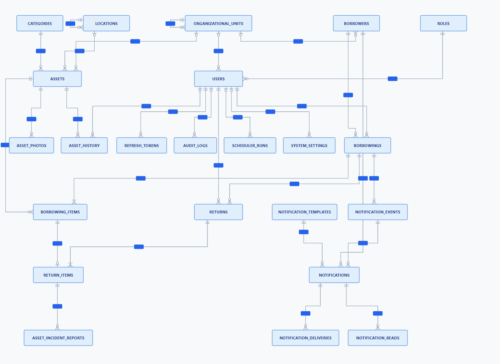
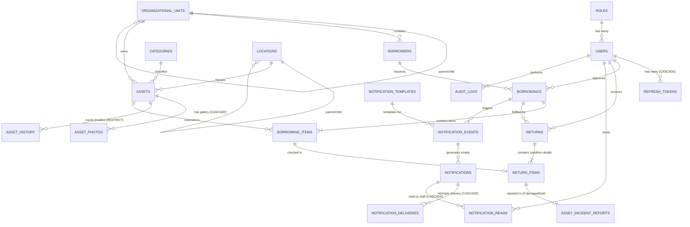

# 🏛️ Dokumentasi Entity Relationship Diagram (ERD) Basis Data SIIPB

Dokumen ini memuat spesifikasi teknis arsitektur basis data, Entity Relationship Diagram (ERD), kamus data (*data dictionary*), dan aturan integritas relasional untuk **Sistem Informasi Inventaris, Peminjaman, dan Pengembalian Barang (SIIPB)**.

---

## 1. Ikhtisar Arsitektur Basis Data

- **Database Engine:** MariaDB 11+ / MariaDB 13 (InnoDB Engine)
- **Karakter Set & Kolasi:** `utf8mb4` / `utf8mb4_unicode_ci`
- **Manajemen Migrasi:** Alembic (`backend/alembic/versions`)
- **Status Skema Aktif:** Head Revision `d4e8b1a5f920`
- **Total Tabel:** **23 Tabel Aplikasi** (+ 1 tabel metadata `alembic_version`)
- **Prinsip Utama:**
  1. **Strict Data Integrity:** Konstrain `ON DELETE RESTRICT` pada seluruh relasi historis dan finansial transaksi.
  2. **Non-Destructive History:** Perubahan status dan mutasi lokasi dicatat *append-only* (`asset_history`, `audit_logs`).
  3. **Idempotent Notifications:** Pengiriman notifikasi berbasis kunci idempotensi unik `UNIQUE(borrowing_id, event_code)` untuk mencegah duplikasi email.
  4. **Pessimistic Concurrency Safe:** Transaksi peminjaman dilindungi *Row-level Locking* (`SELECT ... FOR UPDATE`) untuk mencegah *double-checkout*.

---

## 2. Diagram Relasi Entitas (ERD) Resmi

Diagram visual skema aktif 23 tabel produksi SIIPB menggunakan notasi standar Crow's Foot:

  

### 🔗 Berkas Diagram Terkait:
- **Visual Vektor (Lossless SVG):** [`database/ERD.svg`](../database/ERD.svg)
- **Visual Gambar (PNG):** [`database/ERD.png`](../database/ERD.png)
- **Penampil Interaktif (Pan/Zoom):** [`docs/SIIPB_ERD_diagram.html`](SIIPB_ERD_diagram.html) *(Buka langsung pada peramban web untuk zoom interaktif dan inspeksi relasi)*
- **DDL Skema SQL:** [`database/SIIPB.sql`](../database/SIIPB.sql)

---

## 3. Matriks Relasi Antar Tabel (Entity Relationships)

Berikut adalah rekapitulasi relasi kunci antar tabel dalam basis data:

---

## 4. Kamus Data & Domain Fungsional

### Domain 1: Pengguna & Hak Akses (RBAC)

#### `roles`
Menyimpan master peran otorisasi sistem.
- `id` (BIGINT UNSIGNED, PK, AI)
- `name` (VARCHAR(50), UNIQUE, NOT NULL): Kode nama peran (`ADMIN`, `PETUGAS_SARPRAS`, `PIMPINAN`).
- `description` (VARCHAR(255)): Deskripsi peran.
- `is_system` (BOOLEAN, DEFAULT 0): Penanda peran bawaan sistem (tidak dapat dihapus).
- `permissions` (LONGTEXT / JSON, NOT NULL): Daftar izin granular dalam format JSON (mis. `["asset.create", "borrowing.checkout"]`).
- `created_at`, `updated_at` (TIMESTAMP)

#### `users`
Menyimpan akun pengguna internal yang memiliki akses login.
- `id` (BIGINT UNSIGNED, PK, AI)
- `role_id` (BIGINT UNSIGNED, FK -> `roles.id`, ON DELETE RESTRICT): Peran pengguna.
- `username` (VARCHAR(50), UNIQUE, NOT NULL)
- `email` (VARCHAR(100), UNIQUE, NOT NULL)
- `password_hash` (VARCHAR(255), NOT NULL)
- `full_name` (VARCHAR(100), NOT NULL)
- `phone` (VARCHAR(20))
- `is_active` (BOOLEAN, DEFAULT 1)
- `google_id` (VARCHAR(255), UNIQUE, NULLABLE): ID OAuth Google untuk SSO.
- `google_email` (VARCHAR(255), NULLABLE)
- `created_at`, `updated_at` (TIMESTAMP)

#### `refresh_tokens`
Menyimpan hash refresh token JWT untuk menjaga sesi login.
- `id` (BIGINT UNSIGNED, PK, AI)
- `user_id` (BIGINT UNSIGNED, FK -> `users.id`, ON DELETE CASCADE)
- `token_hash` (VARCHAR(64), UNIQUE, NOT NULL): Hash SHA-256 token.
- `expires_at` (DATETIME, NOT NULL)
- `revoked_at` (DATETIME, NULLABLE)
- `created_at` (TIMESTAMP)

---

### Domain 2: Master Organisasi & Peminjam

#### `organizational_units`
Menyimpan struktur hierarkis unit kerja / program studi / departemen pemilik aset atau peminjam.
- `id` (BIGINT UNSIGNED, PK, AI)
- `parent_id` (BIGINT UNSIGNED, FK -> `organizational_units.id`, ON DELETE RESTRICT, NULLABLE): Relasi hierarki pohon.
- `name` (VARCHAR(100), NOT NULL)
- `code` (VARCHAR(20), UNIQUE, NOT NULL)
- `is_active` (BOOLEAN, DEFAULT 1)
- `created_at`, `updated_at` (TIMESTAMP)

#### `borrowers`
Master data peminjam barang (**tanpa akun login** ke sistem).
- `id` (BIGINT UNSIGNED, PK, AI)
- `unit_id` (BIGINT UNSIGNED, FK -> `organizational_units.id`, ON DELETE RESTRICT)
- `identification_number` (VARCHAR(50), UNIQUE, NOT NULL): NIM / NIP / NIK.
- `name` (VARCHAR(100), NOT NULL)
- `email` (VARCHAR(100), NOT NULL)
- `phone` (VARCHAR(20), NOT NULL)
- `is_active` (BOOLEAN, DEFAULT 1)
- `created_at`, `updated_at` (TIMESTAMP)

---

### Domain 3: Master Inventaris & Lokasi

#### `categories`
Master kategori pengelompokan jenis barang inventaris.
- `id` (BIGINT UNSIGNED, PK, AI)
- `name` (VARCHAR(100), UNIQUE, NOT NULL)
- `code` (VARCHAR(20), UNIQUE, NOT NULL)
- `description` (TEXT)
- `is_active` (BOOLEAN, DEFAULT 1)
- `created_at`, `updated_at` (TIMESTAMP)

#### `locations`
Master hierarkis lokasi fisik penyimpanan aset (Gedung > Lantai > Ruangan).
- `id` (BIGINT UNSIGNED, PK, AI)
- `parent_id` (BIGINT UNSIGNED, FK -> `locations.id`, ON DELETE RESTRICT, NULLABLE): Relasi hierarki pohon.
- `name` (VARCHAR(100), NOT NULL)
- `code` (VARCHAR(20), UNIQUE, NOT NULL)
- `is_active` (BOOLEAN, DEFAULT 1)
- `created_at`, `updated_at` (TIMESTAMP)

---

### Domain 4: Manajemen Aset Fisik

#### `assets`
Data induk fisik unit barang inventaris.
- `id` (BIGINT UNSIGNED, PK, AI)
- `category_id` (BIGINT UNSIGNED, FK -> `categories.id`, ON DELETE RESTRICT)
- `location_id` (BIGINT UNSIGNED, FK -> `locations.id`, ON DELETE RESTRICT)
- `owner_unit_id` (BIGINT UNSIGNED, FK -> `organizational_units.id`, ON DELETE RESTRICT)
- `inventory_code` (VARCHAR(50), UNIQUE, NOT NULL): Kode inventaris unik.
- `serial_number` (VARCHAR(100), UNIQUE, NULLABLE): Nomor seri pabrik.
- `name` (VARCHAR(150), NOT NULL)
- `status` (VARCHAR(30), DEFAULT 'TERSEDIA'): `TERSEDIA`, `DIPINJAM`, `RUSAK`, `HILANG`, `DALAM_PERBAIKAN`, `DIPERBAIKI`, `DIHAPUS`.
- `condition_status` (VARCHAR(30), DEFAULT 'BAIK'): `BAIK`, `RUSAK_RINGAN`, `RUSAK_BERAT`, `HILANG`.
- `description` (TEXT)
- `created_at`, `updated_at` (TIMESTAMP)

#### `asset_photos`
Galeri foto fisik aset (maksimal 5 foto per aset).
- `id` (BIGINT UNSIGNED, PK, AI)
- `asset_id` (BIGINT UNSIGNED, FK -> `assets.id`, ON DELETE CASCADE)
- `path` (VARCHAR(255), NOT NULL): Path relatif lokal atau kunci/URL S3.
- `is_primary` (BOOLEAN, DEFAULT 0): Penanda foto profil utama.
- `sort_order` (INT, DEFAULT 0): Urutan tampilan foto (0-4).
- `created_at` (TIMESTAMP)

#### `asset_history`
Rekam jejak kronologis perpindahan lokasi, status, dan mutasi barang (*append-only*).
- `id` (BIGINT UNSIGNED, PK, AI)
- `asset_id` (BIGINT UNSIGNED, FK -> `assets.id`, ON DELETE RESTRICT)
- `changed_by` (BIGINT UNSIGNED, FK -> `users.id`, ON DELETE SET NULL, NULLABLE)
- `event_type` (VARCHAR(50), NOT NULL): Jenis aksi perubahan.
- `old_status`, `new_status` (VARCHAR(30))
- `old_location_id`, `new_location_id` (BIGINT UNSIGNED, FK -> `locations.id`, ON DELETE RESTRICT, NULLABLE)
- `notes` (TEXT)
- `created_at` (TIMESTAMP)

---

### Domain 5: Transaksi Peminjaman

#### `borrowings`
Header transaksi sirkulasi peminjaman barang.
- `id` (BIGINT UNSIGNED, PK, AI)
- `borrower_id` (BIGINT UNSIGNED, FK -> `borrowers.id`, ON DELETE RESTRICT)
- `created_by` (BIGINT UNSIGNED, FK -> `users.id`, ON DELETE RESTRICT): Petugas yang memproses.
- `borrowing_code` (VARCHAR(50), UNIQUE, NOT NULL): Nomor transaksi resmi (mis. `PB-202610-0001`).
- `start_date` (DATETIME, NOT NULL): Waktu barang diambil.
- `expected_return_date` (DATETIME, NOT NULL): Waktu tenggat pengembalian (`CHECK (expected_return_date >= start_date)`).
- `actual_return_date` (DATETIME, NULLABLE): Waktu seluruh barang selesai dikembalikan.
- `status` (VARCHAR(30), DEFAULT 'DIPINJAM'): `DIPINJAM`, `KEMBALI`, `TERLAMBAT`, `HILANG`.
- `purpose` (TEXT, NOT NULL): Keperluan peminjaman.
- `notes` (TEXT)
- `created_at`, `updated_at` (TIMESTAMP)

#### `borrowing_items`
Rincian item unit barang yang dipinjam dalam satu transaksi.
- `id` (BIGINT UNSIGNED, PK, AI)
- `borrowing_id` (BIGINT UNSIGNED, FK -> `borrowings.id`, ON DELETE RESTRICT)
- `asset_id` (BIGINT UNSIGNED, FK -> `assets.id`, ON DELETE RESTRICT)
- `notes` (TEXT)
- `created_at` (TIMESTAMP)

---

### Domain 6: Transaksi Pengembalian & Penanganan Insiden

#### `returns`
Header pencatatan pengembalian barang.
- `id` (BIGINT UNSIGNED, PK, AI)
- `borrowing_id` (BIGINT UNSIGNED, FK -> `borrowings.id`, ON DELETE RESTRICT)
- `received_by` (BIGINT UNSIGNED, FK -> `users.id`, ON DELETE RESTRICT): Petugas penerima.
- `return_code` (VARCHAR(50), UNIQUE, NOT NULL): Nomor pengembalian resmi (mis. `RT-202610-0001`).
- `return_date` (DATETIME, NOT NULL)
- `notes` (TEXT)
- `created_at` (TIMESTAMP)

#### `return_items`
Pemeriksaan kondisi fisik setiap unit barang saat diserahkan kembali.
- `id` (BIGINT UNSIGNED, PK, AI)
- `return_id` (BIGINT UNSIGNED, FK -> `returns.id`, ON DELETE RESTRICT)
- `borrowing_item_id` (BIGINT UNSIGNED, FK -> `borrowing_items.id`, ON DELETE RESTRICT)
- `condition_status` (VARCHAR(30), NOT NULL): `BAIK`, `RUSAK_RINGAN`, `RUSAK_BERAT`, `HILANG`.
- `notes` (TEXT)
- `created_at` (TIMESTAMP)

#### `asset_incident_reports`
Pencatatan kasus insiden barang rusak atau hilang yang membutuhkan estimasi biaya ganti rugi atau alur perbaikan.
- `id` (BIGINT UNSIGNED, PK, AI)
- `return_item_id` (BIGINT UNSIGNED, FK -> `return_items.id`, ON DELETE RESTRICT)
- `incident_type` (VARCHAR(20), NOT NULL): `DAMAGE` atau `LOSS`.
- `description` (TEXT, NOT NULL)
- `estimated_cost` (DECIMAL(12, 2), DEFAULT 0.00)
- `actual_cost` (DECIMAL(12, 2), NULLABLE)
- `repaired_at` (DATETIME, NULLABLE)
- `status` (VARCHAR(30), DEFAULT 'PENDING'): `PENDING`, `IN_REPAIR`, `REPAIRED`, `REPLACED`, `WRITTEN_OFF`.
- `reported_at` (DATETIME, NOT NULL)
- `created_at`, `updated_at` (TIMESTAMP)

---

### Domain 7: Engine Notifikasi Idempoten & Jadwal

#### `notification_templates`
Master template email dengan variabel dinamis (`{{borrower_name}}`, `{{borrowing_code}}`, dsb.).
- `id` (BIGINT UNSIGNED, PK, AI)
- `code` (VARCHAR(50), UNIQUE, NOT NULL): Kode template (`REMINDER_H3`, `REMINDER_H1`, `DUE_DATE`, `OVERDUE_H1`, `ESCALATION_UNIT`, dsb.).
- `name` (VARCHAR(100), NOT NULL)
- `subject_template` (VARCHAR(255), NOT NULL)
- `body_template` (TEXT, NOT NULL)
- `is_active` (BOOLEAN, DEFAULT 1)
- `created_at`, `updated_at` (TIMESTAMP)

#### `notification_events`
Tabel kunci idempotensi untuk mencegah duplikasi pemrosesan antrean dan jadwal notifikasi.
- `id` (BIGINT UNSIGNED, PK, AI)
- `borrowing_id` (BIGINT UNSIGNED, FK -> `borrowings.id`, ON DELETE RESTRICT): ID transaksi peminjaman terkait.
- `event_code` (VARCHAR(50), NOT NULL): Kode tipe event (`LOAN_CONFIRMATION`, `RETURN_CONFIRMATION`, `REMINDER_H3`, `REMINDER_H1`, `DUE_DATE`, `OVERDUE_H1`, `ESCALATION_UNIT`, dsb.).
- `scheduled_at` (DATETIME(6), NOT NULL): Waktu jadwal eksekusi event.
- `processed_at` (DATETIME(6), NULLABLE): Waktu event selesai dieksekusi oleh worker.
- `status` (VARCHAR(30), DEFAULT 'PENDING'): Status eksekusi event (`PENDING`, `PROCESSING`, `PROCESSED`, `SKIPPED`, `FAILED`).
- `created_at` (DATETIME(6), NOT NULL, DEFAULT CURRENT_TIMESTAMP(6))
- **Constraints & Indexes:**
  - `UNIQUE KEY (borrowing_id, event_code)`: Menjamin 1 event_code hanya terpicu 1 kali per peminjaman (Idempotency Key).
  - `INDEX (status, scheduled_at)`: Optimasi query polling scheduler/worker.
  - `CHECK (status IN ('PENDING', 'PROCESSING', 'PROCESSED', 'SKIPPED', 'FAILED'))`.

#### `notifications`
Snapshot surat notifikasi yang disiapkan untuk dikirim per penerima (Peminjam, Petugas, atau Pimpinan).
- `id` (BIGINT UNSIGNED, PK, AI)
- `event_id` (BIGINT UNSIGNED, FK -> `notification_events.id`, ON DELETE RESTRICT): Relasi ke event pemicu.
- `borrower_id` (BIGINT UNSIGNED, FK -> `borrowers.id`, ON DELETE RESTRICT): Peminjam terkait.
- `template_id` (BIGINT UNSIGNED, FK -> `notification_templates.id`, ON DELETE RESTRICT): Template email yang digunakan.
- `channel` (VARCHAR(20), DEFAULT 'EMAIL', CHECK `channel = 'EMAIL'`): Kanal pengiriman.
- `recipient` (VARCHAR(255), NOT NULL): Alamat email tujuan pengiriman.
- `recipient_name` (VARCHAR(150), NULLABLE): Nama penerima.
- `recipient_type` (VARCHAR(20), DEFAULT 'PEMINJAM', CHECK `recipient_type IN ('PEMINJAM', 'PETUGAS', 'PIMPINAN')`)
- `recipient_user_id` (BIGINT UNSIGNED, FK -> `users.id`, ON DELETE SET NULL, NULLABLE): ID user internal jika penerima adalah petugas/pimpinan.
- `subject` (VARCHAR(255), NULLABLE): Subjek email hasil render template.
- `body_snapshot` (TEXT, NULLABLE): Konten isi pesan hasil render template (*frozen snapshot*).
- `status` (VARCHAR(30), DEFAULT 'QUEUED', CHECK `status IN ('QUEUED', 'PROCESSING', 'SENT', 'FAILED', 'RETRYING')`)
- `sent_at` (DATETIME(6), NULLABLE): Waktu notifikasi berhasil terkirim.
- `created_at` (DATETIME(6), NOT NULL, DEFAULT CURRENT_TIMESTAMP(6))

#### `notification_deliveries`
Catatan siklus hidup pengiriman per percobaan SMTP (termasuk pesan error dan retry).
- `id` (BIGINT UNSIGNED, PK, AI)
- `notification_id` (BIGINT UNSIGNED, FK -> `notifications.id`, ON DELETE CASCADE)
- `attempt_number` (INT, NOT NULL)
- `status` (VARCHAR(30), NOT NULL): `SUCCESS` atau `FAILED`.
- `error_message` (TEXT, NULLABLE)
- `attempted_at` (DATETIME, NOT NULL)

#### `notification_reads`
Pencatatan status notifikasi sudah dibaca oleh staf/admin internal.
- `id` (BIGINT UNSIGNED, PK, AI)
- `notification_id` (BIGINT UNSIGNED, FK -> `notifications.id`, ON DELETE CASCADE)
- `user_id` (BIGINT UNSIGNED, FK -> `users.id`, ON DELETE CASCADE)
- `read_at` (DATETIME, NOT NULL)
- **Constraint Unik:** `UNIQUE(notification_id, user_id)`

#### `scheduler_runs`
Log audit eksekusi otomatis pemeriksaan jatuh tempo berkala (Celery Beat).
- `id` (BIGINT UNSIGNED, PK, AI)
- `task_name` (VARCHAR(100), NOT NULL)
- `run_date` (DATETIME, NOT NULL)
- `status` (VARCHAR(30), NOT NULL): `SUCCESS` atau `FAILED`.
- `summary` (TEXT)
- `created_at` (TIMESTAMP)

---

### Domain 8: Konfigurasi Sistem & Audit Log

#### `system_settings`
Parameter operasional sistem dinamis (*key-value*).
- `id` (BIGINT UNSIGNED, PK, AI)
- `key` (VARCHAR(100), UNIQUE, NOT NULL): Jam notifikasi, batas hari pinjam, SMTP config, S3 config, dsb.
- `value` (TEXT, NOT NULL)
- `description` (TEXT)
- `is_secret` (BOOLEAN, DEFAULT 0): Menandakan nilai terenkripsi/rahasia (mis. password SMTP).
- `updated_by` (BIGINT UNSIGNED, FK -> `users.id`, ON DELETE SET NULL, NULLABLE)
- `updated_at` (TIMESTAMP)

#### `audit_logs`
Catatan rekam jejak audit keamanan (*append-only*, non-editable).
- `id` (BIGINT UNSIGNED, PK, AI)
- `user_id` (BIGINT UNSIGNED, FK -> `users.id`, ON DELETE SET NULL, NULLABLE)
- `action` (VARCHAR(100), NOT NULL): Kode aksi (mis. `ASSET_CREATED`, `CHECKOUT_APPROVED`).
- `target_type` (VARCHAR(50), NOT NULL): Nama tabel sasaran.
- `target_id` (BIGINT UNSIGNED, NULLABLE): ID record sasaran.
- `ip_address` (VARCHAR(45), NULLABLE)
- `user_agent` (TEXT, NULLABLE)
- `details` (LONGTEXT / JSON, NULLABLE): Snapshot data sebelum dan sesudah perubahan.
- `timestamp` (TIMESTAMP, NOT NULL)

---

## 5. Ringkasan Konsolidasi Skema Terkini

Berdasarkan hasil refactoring dan simplifikasi skema produksi (Alembic `c1f9e2b8a341` & `d4e8b1a5f920`), berikut ringkasan tabel yang disederhanakan:

1. **`damage_reports` + `loss_reports` ➔ `asset_incident_reports`**  
   Dua tabel insiden digabung menjadi satu tabel dengan diskriminator `incident_type` (`DAMAGE` / `LOSS`), menyederhanakan alur ganti rugi dan perbaikan barang.
2. **`email_deliveries` + `notification_logs` ➔ `notification_deliveries`**  
   Pencatatan percobaan pengiriman email disatukan dengan pelacakan nomor percobaan (`attempt_number`) dan log error.
3. **`user_roles` ➔ `users.role_id`**  
   Relasi *many-to-many* peran pengguna disederhanakan menjadi relasi langsung 1 pengguna = 1 role (`users.role_id`).
4. **`external_identities` ➔ `users.google_id` & `google_email`**  
   Kredensial OAuth Google SSO diintegrasikan langsung pada kolom tabel `users`.
5. **`permissions` + `role_permissions` ➔ `roles.permissions` (JSON)**  
   Katalog 16 permission granular dikelola secara statis pada kode backend (`app/models/permission.py`) dan disimpan sebagai array string JSON pada kolom `roles.permissions`.
6. **Master Peminjam (`borrowers`) Tetap Terpisah dari `users`**  
   Peminjam adalah sivitas/publik yang meminjam barang fisik tanpa perlu membuat akun login, menjaga privasi dan kecepatan pelayanan petugas.
7. **Penyimpanan Foto (`asset_photos`) vs Object Storage (S3)**  
   Tabel `asset_photos` berfungsi menyimpan metadata relasional (kepemilikan `asset_id`, status foto utama `is_primary`, dan urutan galeri `sort_order`), sedangkan berkas biner disimpan di MinIO/S3 atau volume lokal.

---
*Dokumentasi ini otomatis disinkronkan dengan skema database MariaDB 13 SIIPB aktif.*
